<!-- _class: lead -->
<!-- _paginate: false -->

# 動画基礎 第4回 前編
## 横丁見本の素材で、操作をひととおり

2026年10月16日（金）1講時
京都芸術デザイン専門学校
キャラクターデザインコース

---

# 本日の授業目標

1. **縦横比とSNS向け画面設計** を学ぶ
2. **テロップ・BGM・効果音** を配置する
3. **短い練習動画を書き出す**

---

# 本日の流れ：2コマで1本

| | 前編（1講時） | 後編（2講時） |
|---|---|---|
| 素材 | **横丁見本の素材**（全員同じ） | **自分の素材**（第3回に撮ったもの） |
| やること | Premiereの操作を、ハンズオンで1つずつ試す | 構成を決めて、30秒の縦動画を作る |
| 終わりに | 練習のシーケンスを書き出す | 書き出して提出し、横丁で撮るカット5つを書く |

- 前編は全員が同じ素材なので、**講師の画面と同じになれば合っている**
- 1か所試せたら先へ進むのは、後編で自分の素材にもう一度当てはめるから

<!-- 前編で全部を仕上げなくていい、と最初に言っておくと焦らずについてこられる -->

---

<!-- _class: work -->

# 出席確認のあいだに

1. `書類/動画基礎/03_shooting/footage/` に、**第3回の素材** が入っているか確かめる
2. 入っていない人は、先週提出した **Googleドライブ** からダウンロードしておく（後編で使う）
3. Classroom の **横丁見本のPremiere版（zip）** をダウンロードして展開する
4. 中のプロジェクトを開く（前編はすべてこのプロジェクトでやる）

<!-- 素材が3本未満の学生・第3回の欠席者には講師の予備素材を配る。Driveから戻せた学生がいれば「バックアップが役に立った」と一言 -->

---

# 完成見本：後編の終わりに、これを自分の素材で

- 教室の素材で作った **30秒の縦動画**（テロップ・BGM・効果音・演出入り）
- 後編では、これと同じものを **自分の素材** で書き出して提出する

<!-- 講師が教室の素材で作った完成見本を再生する。途中版（穴が残ったもの）は後編の頭で見せるので、ここでは完成版だけ -->

---

<!-- _class: side -->

# 前編の素材：横丁見本の部品

第3回に見た **横丁の30秒** を、Premiereの部品に分けたもの

- 写真・文字・ステッカー・図形・BGMが、ビンに入っている
- 派手に見える動きも、**部品を重ねてキーフレームで動かしているだけ**
- 前編の最後のほうで、この動きを4つ再現する

<video class="v-side" src="videos/yokocho_mg.mp4" poster="images/a_yokocho_poster.jpg" controls playsinline preload="metadata"></video>

---

# 前編で作る練習のシーケンス

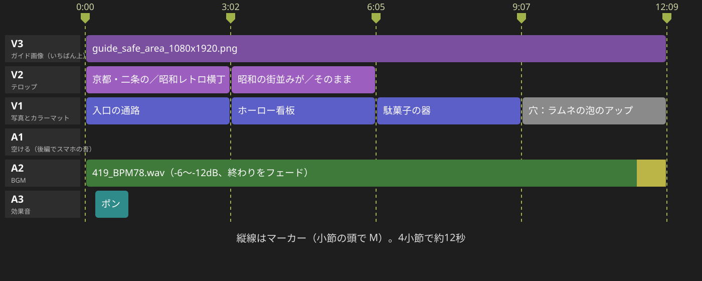

①〜⑤で1本の練習のシーケンス `practice_yokocho` を積み上げ、⑦で書き出す（⑥だけは用意したシーケンスでやる）

<!-- 操作を1つ見せるたびに「その演出には撮影で何が要るか」を言う。写真の素材では出てこない切りどころ・手ブレ・スマホの音は後編で拾う -->

---

<!-- _class: lead -->

# 前編 ハンズオン

①シーケンス → ②BGMとマーカー → ③並べる・穴 → ④テロップ → ⑤音 → ⑥動き → ⑦書き出し

---

<!-- _class: work -->

# ハンズオン① 縦のシーケンスを作る（10分）

1. XMLと同じ名前のビンを開き、写真・文字・BGMが入っているのを確かめる（写真は縦 1080×1920）
2. ファイル ＞ 新規 ＞ シーケンス ＞「設定」タブで、次のように決める

| 項目 | 設定 |
|---|---|
| 編集モード | カスタム |
| タイムベース | 30 フレーム/秒 |
| フレームサイズ | 横 **1080**・縦 **1920**（SNSの9:16の縦動画はこの大きさ） |
| シーケンス名 | `practice_yokocho` |

<!-- 【要確認：教室の版での項目名と、縦のプリセットがあるか】 -->

---

# ① セーフエリアのガイドを重ねる

3. ガイド画像 `guide_safe_area_1080x1920.png` を読み込んで **V3** に置き、**約12秒（4小節）** まで伸ばす

- 赤いところは、投稿するとアプリの表示に隠れる
- 青に主役、橙に文字を置く
- WB Day4 のセーフマージンはテレビ向けの枠なので、縦のSNSには合わない

### よく見るつまずき
- 素材を「新規項目」にドラッグして、**素材に合わせたシーケンス** ができてしまう
- ガイド画像を下のトラックに置いて、写真に隠れる

---

<!-- _class: work -->

# ハンズオン② BGMとマーカー（8分）

1. ビンの `419_BPM78.wav` を **A2** に置く（**A1** は後編でスマホの音を置くので空ける）
2. 曲の頭の **0.6秒ほどの無音** をトリミングする
3. クリップを何も選ばずに再生し、小節の頭で <kbd>M</kbd> を押す（前編は **4つ**）
4. スナップ <kbd>S</kbd>（磁石）をオンにすると、カットの端がマーカーに吸い付く

- BPM78 は4拍（1小節）が **約3.08秒** なので、1小節に1カットで第3回の「1カット2〜4秒」に収まる
- ずれたマーカーは、右クリック ＞「選択したマーカーを消去」で消して打ち直す

> 撮影とのつながり：拍で切るには、1カット **5〜10秒** の長さと、動きの前後の「止め」が要る

---

<!-- _class: work -->

# ハンズオン③ 写真を3小節並べる（8分）

1. マーカーとマーカーの間に、写真を1小節ずつ **V1** に置く
   - 1小節目 `c02_入口の通路.jpg`
   - 2小節目 `c07_ホーロー看板.jpg`
   - 3小節目 `c05_駄菓子の器.jpg`
2. 静止画は決まった長さ（初期設定で **5秒**）で入るので、端をマーカーに合わせて詰める
3. 4小節目には、次のページの **カラーマットの穴** を置く

<!-- 置き方と切り方は第2回と同じ。写真なので切りどころの話は後編の自分の素材で -->

---

# ③ 4小節目にカラーマットの「穴」を置く

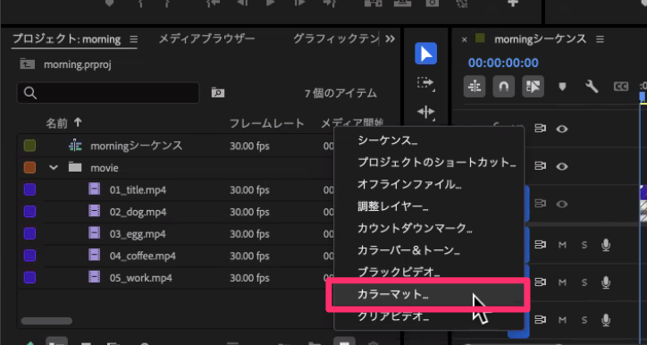 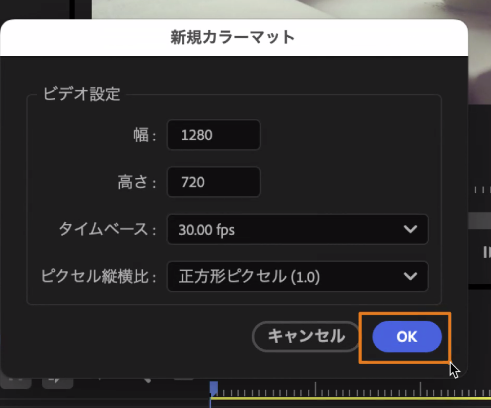 

プロジェクトパネル ＞ **新規項目 ＞ カラーマット** で灰色を作り、名前を **「穴：ラムネの泡のアップ」** にして置く

クリップ名がタイムラインに出るので、文字ツールを使わなくても中身が分かる

---

<!-- _class: hook -->

# 穴の数 ＝ 撮っていないカットの数

## 横丁見本の素材には、ラムネのカットがない

ここは来週の横丁で撮るしかない。後編では、構成メモで「なし」になったところに同じように穴を置く。穴は残したままでいい

---

<!-- _class: work -->

# ハンズオン④ テロップを入れる（12分）

1. 横書き文字ツール <kbd>T</kbd> でプログラムモニターをクリックし、入口の通路に2行で打つ
   **京都・二条の／昭和レトロ横丁**
2. プロパティパネルで、フォント・サイズ・色・境界線を次のページの目安に合わせる
3. 使い回す：文字のクリップを選んで <kbd>⌘</kbd>+<kbd>C</kbd> → <kbd>Shift</kbd> を押しながら再生ヘッドを次のカットの頭へ → <kbd>⌘</kbd>+<kbd>V</kbd>
4. ホーロー看板のほうを **昭和の街並みが／そのまま** に打ち替える

> 撮影とのつながり：テロップを読ませるには、**主役の下に文字の場所を空けたカット** が要る

---

# ④ テロップの設定の目安

| 項目 | 目安 | 理由 |
|---|---|---|
| フォント | 源ノ角ゴシック JP の Bold など、太めのゴシック | スマホの小さい画面でも潰れない |
| サイズ | **70〜90px** | 1080の幅に、1行10文字前後が収まる |
| 行数 | 1行10文字前後、2行まで | 右端のアイコンを避けて収まる |
| 色 | 白い文字に黒の境界線（6〜10px）、または背景つき | 明るいカットでも暗いカットでも読める |
| 位置 | ガイドの「文字はここ」の帯 | 下はキャプション、右端はアイコンに隠れる |
| 表示時間 | 2秒以上、文字数÷4 秒が目安 | 1秒に4文字が読める速さ |

---

# ④ できあがりのイメージ

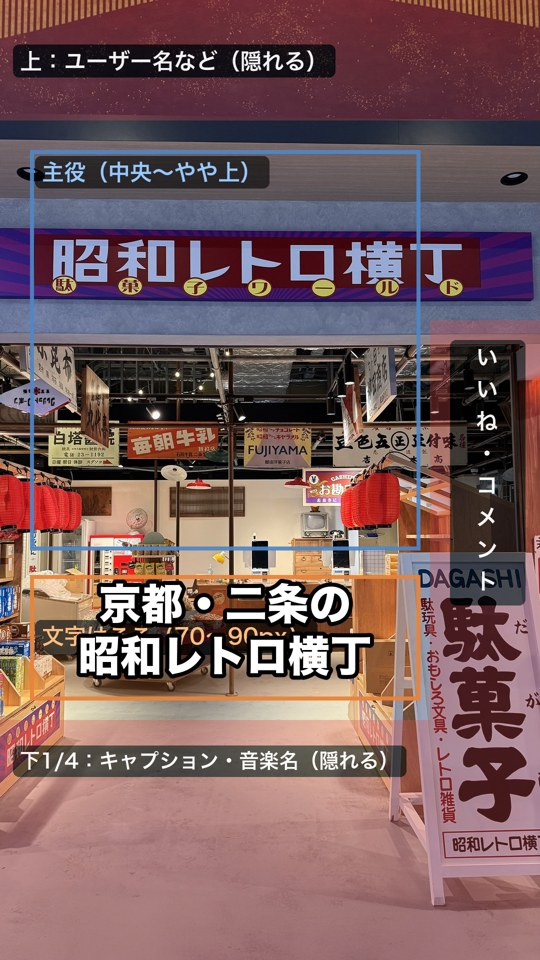 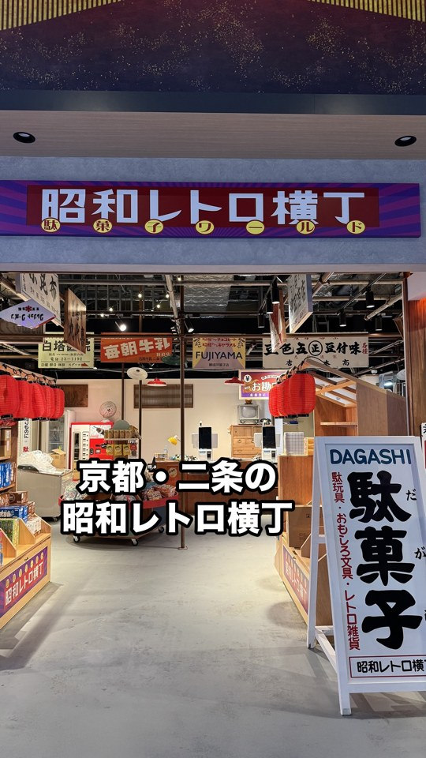

ガイドの橙の帯に収まっていれば、投稿しても隠れない（右はガイドを消したところ）

<!-- 写真のどこに文字を置くかはガイドで決める。後編で文字が主役にかぶったカットは「下を空けて撮っていなかった」カットなので、撮り足しメモに書く、と予告する -->

---

# ④ 文字ツールとプロパティパネル（WB Day5）

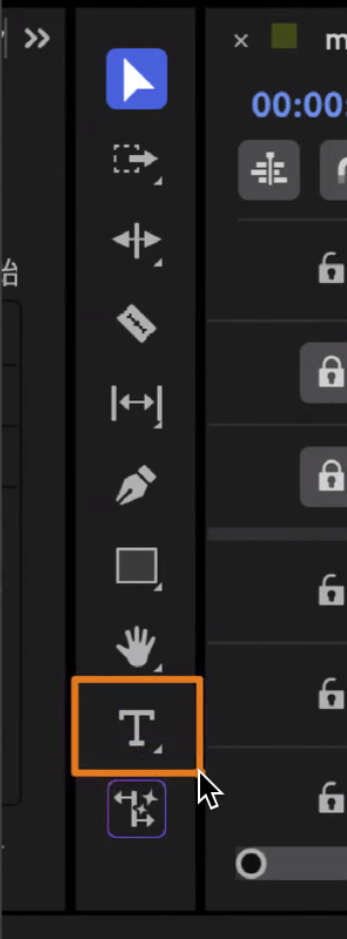 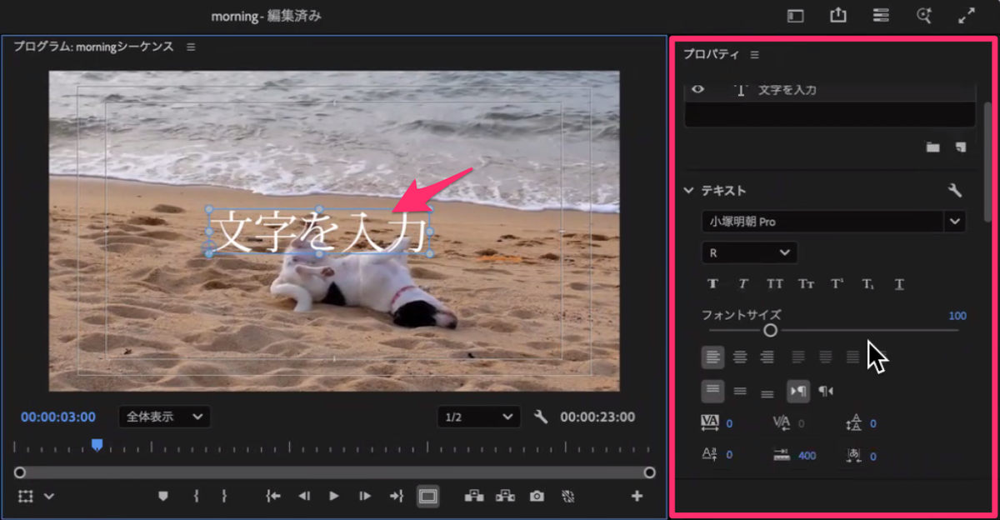

<kbd>T</kbd> でプログラムモニターをクリックして打ち、右のプロパティパネルで整える

---

# ④ 境界線・背景・使い回し（WB Day5）

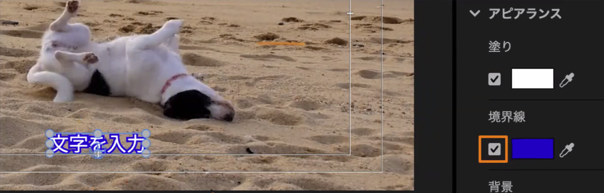 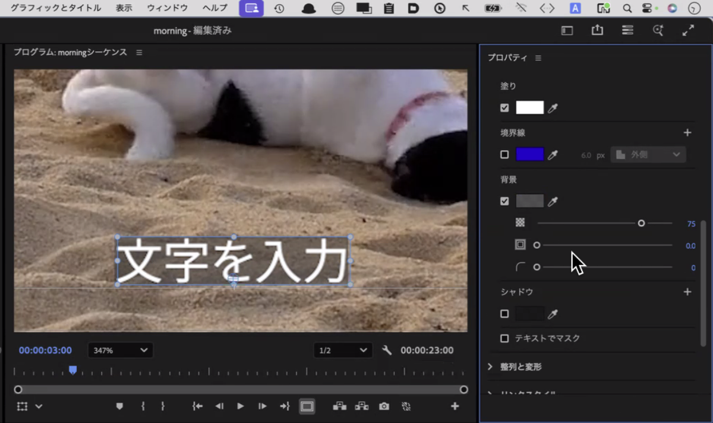

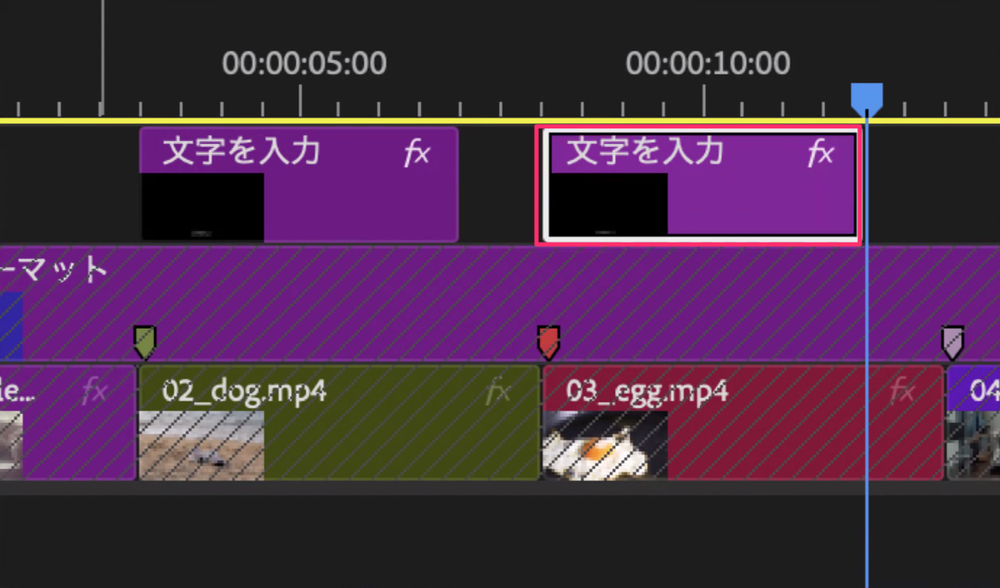

<!-- 背景を色付きにするとステッカー風になる。項目名は教室の版で【要確認】。ポンと出す動きは⑥のBでやる -->

---

<!-- _class: work -->

# ハンズオン⑤ 音を仕上げる（8分）

| トラック | 役割 |
|---|---|
| A1 | スマホの音（後編で自分の素材に入っている） |
| A2 | BGM |
| A3 | 効果音 |

1. BGMを **4つ目のマーカー（約12秒）** でレーザー <kbd>C</kbd> で切り、余りを消す
2. エフェクト ＞ オーディオトランジション ＞ クロスフェード ＞ **コンスタントパワー** を終わりに置き、1秒ほどでフェードアウト
3. BGMのレベルを **-6〜-12dB** あたりにし、メーターのピークが **-6** を超えないようにする
4. 配布の効果音（ポン、キラッなど）を1つ、テロップが出る瞬間に **A3** へ置く（30秒で4か所まで）

---

# ⑤ レーザー、フェード、音量（WB Day5）

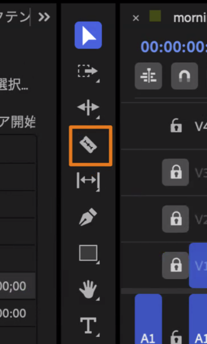 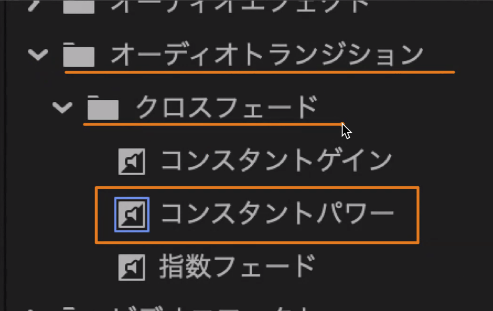 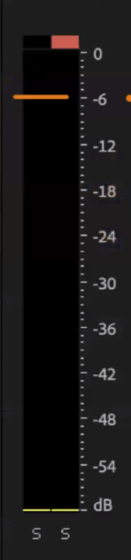

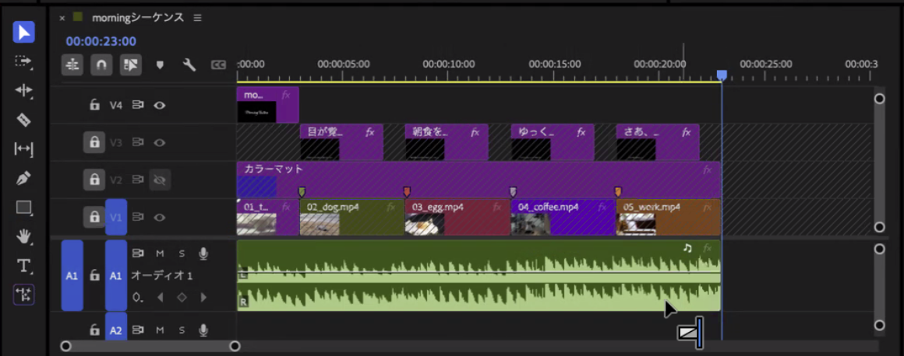 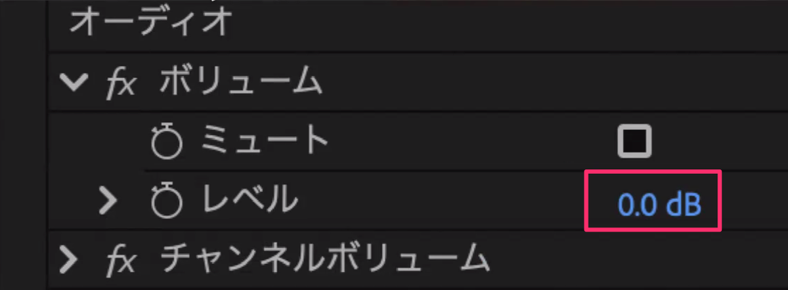

<!-- レベルはエフェクトコントロール ＞ オーディオ ＞ ボリューム ＞ レベル。スマホの音（話し声・風は下げるか「有効」を外す、ざわめきは薄く残す）は後編で、と口で予告 -->

---

<!-- _class: hook -->

# 本物の音は、現地で録るしかない

## ラムネの栓・レジの音・店のざわめき

効果音より強く場所を伝えるけれど、話し声や風が入ると使えないので、横丁では **「音だけのために10秒、静かに撮る」** カットを入れよう

---

<!-- _class: lead -->

# ハンズオン⑥ 横丁見本の動きを再現する（22分）

A ズームパンチ／B ステッカー／C 帯／D フラッシュと円形ワイプ／E（挑戦）ロゴ

---

# 完成形のシーケンスを開いてみる

- 30秒の中に、写真・文字・図形・切り替え・質感の層が **15本のトラック** に重なっている
- クリップを選ぶと、エフェクトコントロールに **キーフレーム** が並んでいる
- 学生は、同じプロジェクトの **ハンズオン用のシーケンス** を開く

| ブロック | 時間 | 置いてあるもの | 課題 |
|---|---|---|---|
| 1 | 00:00〜03:02 | 入口の写真（V1）、ステッカー（V2） | A、B |
| 2 | 03:02〜06:05 | ホーロー看板（V1）、帯2本（V2・V3） | C、D（境目にフラッシュ） |
| 3 | 06:05〜09:07 | 黒電話とミゼット（V1、07:12で切り替わる） | D（円形ワイプ） |
| 4 | 09:07〜12:09 | クリーム（V1）、ロゴ（V2） | E（挑戦） |

時間は「秒:フレーム」で、30フレームで1秒

---

# キーフレームを打つ場所への移り方

- クリップの頭へは、タイムラインで <kbd>↑</kbd> <kbd>↓</kbd> を押すと編集点ごとに移れる
- 何フレームか進めるときは、左上の時間表示をクリックして **`+11`** と打って <kbd>Enter</kbd>
- 1フレームずつなら <kbd>→</kbd>
- エフェクトコントロールの項目の左の **ストップウォッチ** を押すと1つ目が打たれ、そのあとは再生ヘッドを動かして値を変えるだけで増えていく

どの課題も「クリップの頭で1つ目、そこから何フレーム後に2つ目」という形にしてある

---

<!-- _class: work side -->

<video class="v-side" src="videos/a_clip_A.mp4" poster="images/a_yokocho_A.jpg" controls playsinline preload="metadata"></video>

# A 写真にズームパンチ（4分）

1. ブロック1の入口の写真（V1）を選び、エフェクトコントロールの「モーション」を開く
2. クリップの頭（00:00）で、スケールのストップウォッチを押す（**100**）
3. `+11`（00:11）で **118**
4. 終わりの1フレーム前（03:01）で **122**

最初の11フレームで一気に寄り、残りの3秒でじわじわ迫る

> 撮影とのつながり：編集で大きく寄るなら **4K** で撮っておく。ふつうは足で寄って撮る

---

<!-- _class: work side -->

<video class="v-side" src="videos/a_clip_A.mp4" poster="images/a_yokocho_B.jpg" controls playsinline preload="metadata"></video>

# B ステッカーをポンと出す（5分）

1. ステッカー「関西最大級！」（V2）を選び、クリップの頭（00:21）へ
2. スケール **60** と不透明度 **0** で、それぞれストップウォッチを押す
3. `+8`（00:29）でスケール **105**、不透明度 **100**
4. `+5`（01:04）でスケール **100**

105%まで行き過ぎてから戻すので、ポンと弾んで見える

> 撮影とのつながり：ステッカーや帯を置くには、被写体で画面を埋めきらない **余白** が要る

---

<!-- _class: work side -->

<video class="v-side" src="videos/a_clip_C.mp4" poster="images/a_yokocho_C.jpg" controls playsinline preload="metadata"></video>

# C 帯を左右から入れる（4分）

1. 帯「昭和30〜50年代」（V2）の頭（03:11）で、位置のストップウォッチを押し、X を **-540**
2. `+14`（03:25）で X を **540**
3. 2つ目のキーフレームを右クリック ＞ 時間補間法 ＞ **イーズイン**
4. 帯「映画セット風」（V3）の頭（03:20）でも同じようにし、右から入れるので X を **1620** から始めて、`+14`（04:04）で 540

帯の幅は画面と同じ1080なので、中心を1080ずらすと画面の外に隠れる

---

<!-- _class: work side -->

<video class="v-side" src="videos/a_clip_D.mp4" poster="images/a_yokocho_D.jpg" controls playsinline preload="metadata"></video>

# D フラッシュと円形ワイプ（4分）

1. エフェクトパネルの検索欄に「ホワイトアウト」と打ち、ディゾルブの中の **ホワイトアウト** を、ブロック1と2の境目（03:02）にドラッグ
2. ダブルクリックして、デュレーションを **6フレーム** にする
3. 検索欄に「アイリス」と打ち、**アイリス (円形)** を黒電話とミゼットの境目（07:12）に置いて **12フレーム**

- 「ホワイトアウト (レガシー)」は古い版なので使わない
- 26.0 で名前と場所が変わったので、**検索欄で探す** のがいちばん早い

> 撮影とのつながり：動画のカットでは、前後 **1秒の余白** がないと、トランジションで同じコマが繰り返される

<!-- 【要確認：教室の版での表示】 -->

---

# 速度のデモ：スローにするなら何fpsで撮る？

`30fps.mp4` と `60fps.mp4` を並べて、どちらも速度・デュレーションで **50%** にする

<figure><video src="videos/30fps_50.mp4" poster="images/poster_30fps_50.jpg" controls playsinline loop preload="metadata"></video><figcaption>30fps を50%：同じコマが2回ずつで <b>カクカク</b></figcaption></figure>
<figure><video src="videos/60fps_50.mp4" poster="images/poster_60fps_50.jpg" controls playsinline loop preload="metadata"></video><figcaption>60fps を50%：<b>なめらか</b></figcaption></figure>

> 撮影とのつながり：スローにしたいカットは **60fps** か **スローモーション** で撮る

<!-- 講師だけのデモ。PremierePro/01_fps/ の2本。自分のカットで試すのは後編 -->

---

<!-- _class: side -->

<video class="v-side" src="videos/a_clip_E.mp4" poster="images/a_yokocho_E.jpg" controls playsinline preload="metadata"></video>

# E（挑戦）ロゴを落として弾ませる

ロゴ（V2）の位置の **Y** に、キーフレームを4つ打つ（X は 540 のまま）

| 時間 | 位置のY | 何が起きているか |
|---|---|---|
| 09:10（頭） | -480 | 画面の上の外 |
| 09:20（+10） | 840 | 着地（少し下まで行く） |
| 09:24（+4） | 790 | 跳ね返る |
| 09:28（+4） | 820 | 止まる |

着地のときにスケールを 104→97→100 と動かすと、つぶれて戻るように見える

---

# 完成形で答え合わせ

完成形のシーケンスで次のクリップを選ぶと、同じキーフレームが並んでいる

| 課題 | 完成形のどこ | クリップ |
|---|---|---|
| A | 3.1秒〜（カット2） | V1「入口の通路（ズームパンチ）」 |
| B | 3.8秒〜（カット2） | V2「関西最大級！」 |
| C | 18.8秒〜（カット7） | V2・V3 の帯2本 |
| D | 9.3秒（フラッシュ）、22.7秒（円形ワイプ） | V11「フラッシュ」、V12 の切り替え |
| E | 27.8秒〜（カット10） | V4「ロゴ（落ちて弾む）」 |

---

# ほかの動きは、後編の「挑戦」で調べて試す

| 見本の動き | 調べるところ |
|---|---|
| コピーが1文字ずつ跳ねる | 26.2 からの「テキストアニメーター」 |
| 数字が 0→2,000 と増える | Premiereだけでは作れない（After Effects） |
| 水玉・斜めのストライプで切り替わる | エフェクトの「グラデーションワイプ」＋配布の白黒画像 |
| 3段の分割・グリッド | 位置とスケールで並べ、モーションの中のクロップで切る |
| 動きの緩急 | キーフレームを右クリックしてイーズイン・イーズアウト |

リンクつきの一覧は、Classroom の「横丁見本の再現ハンズオン」に載せてある

<!-- 26.0でエフェクトとトランジションが組み替えられたので、2025年以前の記事の名前は見つからないことがある、と一言 -->

---

<!-- _class: work -->

# ハンズオン⑦ 練習のシーケンスを書き出す（5分）

1. ガイド画像のトラック（V3）の **目のアイコンをオフ** にする（忘れると色の帯ごと書き出される）
2. `practice_yokocho` を選んで書き出し：**H.264**、**ソースに一致（アダプティブ高ビットレート）**
3. 概要の欄で **1080×1920** になっているか確かめる
4. 保存先は `03_shooting/export/`、ファイル名は練習なので `test.mp4`
5. 自分のスマホに送って縦で再生し、テロップの大きさと位置を **スマホで** 見る

 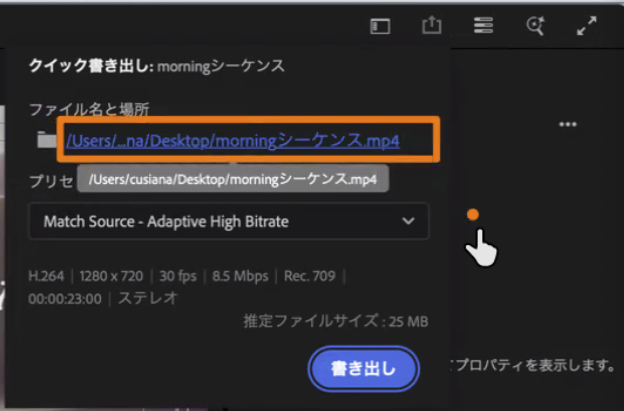

<!-- 押したときは設定画面を見せるだけにして、後編で最初に書き出す学生が出たところで全体に一言補う -->

---

# 前編のまとめ：7つの操作と、撮影で要るもの

| 操作 | 撮影で必要だったこと |
|---|---|
| ① 1080×1920 のシーケンスとガイド | 縦で撮る |
| ② BGMの小節にマーカー | 1カット5〜10秒、動きの前後の止め |
| ③ 並べる・カラーマットの穴 | 穴の数だけ、撮り足すカットがある |
| ④ テロップ | 主役の下に文字の場所を空けたカット |
| ⑤ BGM・効果音・音量 | 話し声と風の入っていない環境音10秒 |
| ⑥ キーフレーム・トランジション・速度 | 余白、前後1秒、4K、60fps |
| ⑦ 書き出し | — |

後編では、この7つを **自分の素材** でもう一度やる

---

# 後編の進め方

まず **最低ライン** で書き出せる状態を作ってから、標準・挑戦へ進む

| 段階 | 入っているもの |
|---|---|
| 最低ライン | 10小節が埋まっている（穴はカラーマットのまま）、テロップ1つ以上、BGMが -6 以下で終わりがフェード、1080×1920で書き出して提出 |
| 標準 | ブロックごとにテロップ、効果音か環境音を1か所以上、演出を1つ以上 |
| 挑戦 | 冒頭1秒の入れ替え、テロップの出し方、横丁見本の動きを1つ試す など |

- 提出の締切は **2講時の1:12**
- そのあとに、**来週の横丁で撮るカット5つ** を書く時間がある

---

<!-- _class: lead -->

# 休み時間の前に <kbd>⌘</kbd>+<kbd>S</kbd>

横丁見本のプロジェクトを保存してから休憩
後編は、自分の素材のフォルダを開いて待っていてください
