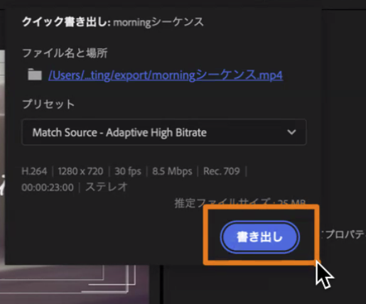

<!-- _class: lead -->
<!-- _paginate: false -->

# 動画基礎 第4回 後編
## 構成を決め、自分の素材で30秒を作る

2026年10月16日（金）2講時
京都芸術デザイン専門学校
キャラクターデザインコース

---

<!-- _class: lead -->

# 休み明けに

第3回の **復習クイズ** をやってください（5問）

そのあいだに、自分の素材のフォルダ `03_shooting/` を開いておきましょう

<!-- Classroomの復習クイズ（復習クイズ_第3回.md）。どの問いも「編集してみて困ったこと」から撮るときの対策を選ぶ形。答え合わせは、前編で困ったことを1〜2人に聞きながら口頭で短く。5問の対策は、最後の「横丁で撮るカット5つ」にそのまま使える -->

---

<!-- _class: hook -->

# 前編で覚えた操作を、
# **自分の素材** でもう一度

## 今日の終わりに、30秒の縦動画を提出します

---

# 本日の授業目標

1. **縦横比とSNS向け画面設計** を学ぶ
2. **テロップ・BGM・効果音** を配置する
3. **短い練習動画を書き出す**

後編では、この3つを自分の素材で通して、書き出して提出するところまでやります。

---

# 後編の流れ

| 時間 | やること |
|---|---|
| 0:00〜0:05 | 復習クイズ |
| 0:05〜0:15 | 撮り足しメモと構成メモ |
| 0:15〜0:20 | 自分のプロジェクトと縦のシーケンスを作る |
| 0:20〜0:45 | **制作①** 並べる・穴を置く・テロップを入れる |
| 0:45〜0:52 | ペアで途中版を見せ合う |
| 0:52〜1:12 | **制作②** 音・演出・仕上げ → **書き出して提出** |
| 1:12〜1:22 | 横丁で撮るカット5つ |
| 1:22〜1:30 | まとめ・理解度クイズ・振り返りシート |

---

<!-- _class: lead -->

# 構成を決める

---

# 撮り足しメモ：「撮っておけばよかった」を1行ずつ

ワークシートの **裏面** に、気づいたときにすぐ書きます。

| やりたかったこと | 足りなかった撮影データ | 横丁ならこう撮る |
|---|---|---|
| ラムネの泡をスローで見せたい | 横丁見本の素材にない | 60fpsかスローモーションで10秒 |
| ペンケースの名前を出したい | 下が空いたカットがなく、文字が物にかぶる | 看板は少し下から撮って、下1/4を空ける |
| 最後に教室全体を見せたい | ロングを撮っていない | 店の入口のロングを5秒止めて2回撮る |

> 前編で置いた「穴：ラムネの泡のアップ」を例に、1行目をみんなで書きましょう

<!-- 講師の完成見本の途中版を見せ、灰色のカラーマットが1つ残っているところで「ここは撮っていなかった」と講師自身が言う。講師にも穴があると分かると、学生も穴を隠さずに出せる -->

---

<!-- _class: work -->

# 構成メモ：素材を見る前に、作りたい30秒を書く（7分）

| ブロック | 小節 | 秒（目安） | 見せたいもの（理想） | 使うカット |
|---|---|---|---|---|
| つかみ | 1 | 0〜3 | 「なにこれ？」と思わせるアップか動き | |
| 推し① | 2 | 3〜9 | | |
| 推し② | 2 | 9〜15 | | |
| 推し③ | 3 | 15〜25 | | |
| 締め | 2 | 25〜31 | 引いて全体を見せ、名前をテロップで | |

- 「見せたいもの」は、撮れているかどうかを気にせずに書く
- 「使うカット」が **なし** になった行に、カラーマットの **穴** を置く
- 小節はBGM（BPM78、1小節 約3.08秒）に合わせてあり、10小節で約31秒

<!-- 素材を先に見ると「撮れたものを並べる」編集になり、足りないものに気づけない。だから理想を先に書き、手持ちのカットを割り当てて、割り当てられないところを穴として残す -->

---

<!-- _class: work -->

# 自分のプロジェクトと縦のシーケンスを作る（5分）


前編の①②を、自分の素材でもう一度やります。

1. 新規プロジェクト：名前 `03_vertical`、場所 `03_shooting/project/`
2. `footage/` を読み込む（「シーケンスを新規作成する」はオフ）
3. 縦のシーケンス：前編と同じ設定で、名前は `vertical_30s`
4. ガイド画像をいちばん上のトラックに置く
5. BGMをA2に置き、小節の頭にマーカーを **10個**（約31秒）

> 終わらなければ、制作①に入ってから続けてかまいません

---

# 前編と違うところ① 素材の大きさとfpsをメモする

前編の写真と違って、自分の動画は撮ったスマホと設定によって中身が違います。

- プロジェクトパネルを **リスト表示** にする
- 「**フレームレート**」と「**ビデオ情報**」（解像度）の列を見る
- 1080×1920 か 2160×3840（4K）か、30fps か 60fps かを、ワークシートの隅にメモ

> スローにできるか、どこまで寄れるかは、この2つで決まります

---

# 前編と違うところ② 動画の素材を置くとき

- 「クリップとシーケンスの設定が一致しません」と出たら **現在の設定を維持**
- 4Kの素材ははみ出すので、右クリック ＞ **フレームサイズに合わせる**
- 似た名前の「フレームサイズに合わせて **スケール**」は、あとで拡大したときに画質が落ちるので選ばない

### よくあるつまずき
- 横で撮った素材を先頭に置いて、横のシーケンスができてしまう
- iPhoneの素材が白っぽく、まぶしく見える（HDRで撮った素材）

<!-- 【要確認】教室のPremiereの版で、iPhoneのHDR素材がどう見えるかと、その対処 -->

---

<!-- _class: lead -->

# 制作①（25分）

並べる・穴を置く・テロップを入れる

---

<style scoped>
table { font-size: 27px; }
td:first-child { white-space: nowrap; font-weight: bold; }
blockquote { font-size: 26px; }
</style>

# 完成の3段階

| 段階 | 入っているもの |
|---|---|
| 最低ライン | 10小節が埋まっている（穴はカラーマットのままでよい）、テロップ1つ以上、BGMが -6 以下で終わりがフェード、1080×1920で書き出して提出 |
| 標準 | ブロックごとにテロップ、効果音か環境音を1か所以上、演出（トランジション・速度・拡大のどれか）を設定値を決めて1つ以上 |
| 挑戦 | 冒頭1秒をいちばん目を引くカットにする／テロップの出し方をつける／効果音をカットの切り替わりに合わせる／手ブレのカットにワープスタビライザー／自分で選んだフリーBGM／横丁見本のチュートリアル集から動きを1つ |

> まず **最低ライン** で書き出せる状態を作ってから、標準・挑戦へ進みましょう

<!-- 制作のあいだ、このスライドを映したままにする。制作①で並べ切ってテロップまで、制作②で音・演出・書き出し、という区切りは目安で、早い学生は先へ進んでよい -->

---

# 自分の素材ならではの注意

前編の写真では出てこなかったことです。

- パンや寄りのカットは、「止め→動き→止め」の **止めを少し残して** 切る
- 止めを撮っていないカットは切りどころがなく、動きの途中から始まってしまう
- カラーマットの **穴を1つ置くたびに**、撮り足しメモに1行書く
- スマホの音（A1）は、話し声や風が入っていれば下げるか「有効」を外す
- ざわめきや物を置く音は、BGMの下に薄く残すと場所の空気が伝わる

---

# 演出を使うときの目安

| 演出 | 目安 |
|---|---|
| トランジション | クロスディゾルブやホワイトアウトは10〜15フレームにして、場面が変わるところと最後だけに付ける。カットの前後に余白がないとストライプが出て、同じコマが繰り返される |
| スロー | 30fpsの素材を50%にしてカクつくときは、時間補間を「オプティカルフロー」にすると間のコマを補える（動きの大きいところは崩れやすい） |
| 寄る | 1080×1920 の素材は110%くらいまでならぼけが目立たず、150%を超えると分かる。4Kの素材は「フレームサイズに合わせる」で50%になっているので、100%まで寄れる |
| 明るさ | Lumetriカラー ＞ 基本補正 ＞ 露光量で、暗いカットは +0.5〜+1 で持ち上がる。白く飛んだところは戻らない |

---

# 挑戦するときのヒント

- **テロップをフェードで出入りさせる**：文字のクリップの頭と終わりにクロスディゾルブ（5〜8フレーム）
- **テロップをポンと出す**：前編⑥のBと同じく、スケールと不透明度にキーフレーム（60→105→100）
- どちらの出し方にするかは、1本の動画の中でそろえる
- **ワープスタビライザー**：かけたあと、周りがどれだけ削れて拡大されたかを見ておく
- **フリーBGM**：出典を第1回のルールどおりメモし、テンポの速い曲は2小節に1カットにすると落ち着く
- **横丁見本のチュートリアル集**：前編の最後のスライドとClassroomにリンクがあります

---

<style scoped>
table { font-size: 15px; }
th, td { padding: 4px 8px; }
h1 { font-size: 34px; margin-bottom: 8px; }
</style>

# 演出と撮影の対応表

| やりたい演出 | Premiereでの操作と設定の目安 | 撮影で必要だったこと |
|---|---|---|
| 曲の拍でカットを切り替える | マーカー（<kbd>M</kbd>）、スナップ（<kbd>S</kbd>）、レーザー（<kbd>C</kbd>） | 1カット5〜10秒の長さと、動きの前後の「止め」 |
| テロップを読ませる | 文字ツール（<kbd>T</kbd>）とプロパティ。70〜90px、2秒以上 | 主役の下にテロップの場所を空けたカット |
| 本物の音で臨場感を出す | A1のスマホの音を残してレベルを調整 | 話し声と風の入っていない環境音を10秒 |
| ステッカーや帯で文字を目立たせる | 文字の背景、スケールと位置のキーフレーム（60→105→100、イーズイン） | 文字や帯を置く余白を空けたカット |
| 切り替えに演出を入れる | ホワイトアウト、アイリス（円形）、クロスディゾルブ（10〜15フレーム） | 動画のカットでは、前後1秒の余白 |
| スローにする | 速度・デュレーションで50% | 60fps（またはスローモーション）で撮った素材 |
| 編集で寄る | スケールのキーフレーム（ズームパンチは 100→118 を11フレーム） | 大きく寄るなら4K、ふつうは足で寄って撮る |
| 暗いカットを明るくする | Lumetriカラー ＞ 基本補正 ＞ 露光量 | 窓を背にして白く飛ばさない |
| 手ブレを抑える | ワープスタビライザー | 両手・脇・肘で固定して撮る（補正すると周りが削れる） |
| 横で撮ったカットを縦で使う | スケールと位置、または自動リフレーム | 縦で撮る（横を縦に収めると左右の約7割が切れる） |
| 冒頭1秒でつかむ | <kbd>option</kbd>＋<kbd>⌘</kbd>ドラッグで並べ替え | 「なにこれ？」と思わせるアップか、動きのあるカット |

---

# 困ったら、それは撮り足しメモの入口

| 編集で困ったこと | 撮るときにしておけば |
|---|---|
| スローがカクカクする | 60fpsかスローモーションで撮る |
| テロップが主役にかぶる | 主役の下を空けて撮る |
| トランジションにストライプが出る | 前後に1秒の余白を残す |
| 拡大するとぼける | 4Kで撮るか、足で寄って撮る |
| 切りどころがない | 動きの前後で2秒止める |
| 手ブレを補正すると周りが大きく削れる | 両手・脇・肘で固定して撮る |

> 操作で直して終わりにせず、「それ、撮り足しメモに書いておこう」

<!-- 巡回で全体に話すのは2回まで。1回目はペアのあと（0:52）に、多かったつまずきを1分で。2回目は締切の10分前（1:02）に、ガイド画像のトラックをオフにして書き出すことと、締切の時刻を伝える。よく見るつまずき：テロップが右端や下1/4にかかる、文字が短すぎて読めない、BGMが大きすぎる、トランジションが全部の繋ぎ目に付いている -->

---

<!-- _class: work -->

# ペアで途中版を見せ合う（7分）

1. 隣の人と、BGMつきで再生し合う
2. 相手の動画の **穴の数** を数える
3. 「このカットがあったら、もっと伝わる」を1つ言う
4. 言われたことも、撮り足しメモに書く

> ここまでで、全員が撮り足しメモに1行以上書けている状態にしましょう

---

<!-- _class: lead -->

# 制作②（20分）

音・演出・仕上げ → 書き出して提出

---

# 書き出し（前編⑦と同じ手順）



1. ガイド画像のトラックの **目のアイコンをオフ** にする（忘れると色の帯ごと書き出される）
2. 右上の書き出しボタンから、ファイル名と場所を決める
3. プリセットは **ソースに一致（アダプティブ高ビットレート）** で、概要が **H.264・1080×1920** になっているかを確かめる
4. 書き出したら自分のスマホに送り、縦で再生して文字の大きさと位置を見る


---

# 提出のルール

| 項目 | 内容 |
|---|---|
| ファイル名 | `学籍番号_氏名_04vertical.mp4` |
| 保存先 | `03_shooting/export/` |
| 提出先 | Classroom「第4回 縦動画」 |
| 締切 | **2講時の残り18分**（このあと、横丁で撮るカットを書きます） |
| コメント欄 | BGMと効果音の出典、カラーマットの穴の数、横丁で撮るカット5つ |

> 穴が残ったままでも提出してかまいません。穴の数と撮り足しメモが書けていれば、今日のねらいは達成です

<!-- 締切は2講時の1:12。教室の時計の時刻を板書する【要確認：2講時の開始時刻】 -->

---

<!-- _class: work -->

# 撮り足しメモを、横丁で撮るカット5つに（10分）

撮り足しメモの「横丁ならこう撮る」から5つ選び、**何を／サイズ／動き／秒数／設定** の形に書き直して、提出のコメント欄に足します。

```
横丁で撮るカット（例）
1. 店の入口　ロング　フィックス　10秒（締め用、下を空ける）
2. ラムネの泡　アップ　60fps　10秒（スロー用）
3. 駄菓子の棚　ミディアム　パン　止め2秒→動き→止め2秒
4. 店内のざわめき　音だけ　10秒　静かに
5. 看板　少し下から　テロップの場所を空ける
```

来週、撮影の現場で自分のスマホから開けるようにしておきましょう。

<!-- 2〜3人に「この演出をやりたかったから、このカットが要る」と理由をつけて発表してもらう。講師は来週の撮影前にこのコメントを見返す -->

---

<!-- _class: lead -->

# まとめ

---

# 本日のまとめ

### 前編：操作をひととおり
- 縦は **1080×1920**、ガイド画像で主役・文字・隠れる場所を見ながら作る
- テロップは **70〜90px・2秒以上**、BGMは **-6 以下** で終わりをフェード

### 後編：自分の素材で30秒
- 構成メモを先に書き、足りないカットは **カラーマットの穴** で残す
- 演出は **撮影の条件とセット** で決まる（60fps、余白、止め、4K、固定）
- 穴と撮り足しメモが、来週の **撮影リスト** になる

---

# 次回の授業

## 第5回：横丁で現地撮影（10/23）

- 今日書いた「横丁で撮るカット5つ」を撮る
- 集合場所と時間は、Classroomで連絡します

### 持ち物
- 充電したスマホ（空き容量 **5GB以上**）
- モバイルバッテリー
- 「横丁で撮るカット5つ」（スマホで開けるように）

<!-- 【要確認】集合場所・時間。シラバスでは10/23は「企画と絵コンテ」なので、現地撮影で確定かどうかも -->

---

<!-- _class: lead -->

# 理解度クイズ

Classroomの理解度クイズ（3問）

---

<!-- _class: lead -->

# 振り返りシート記入

## 本日の行動目標

1. 縦横比とSNS向け画面設計を学ぶ
2. テロップ・BGM・効果音を配置する
3. 短い練習動画を書き出す
