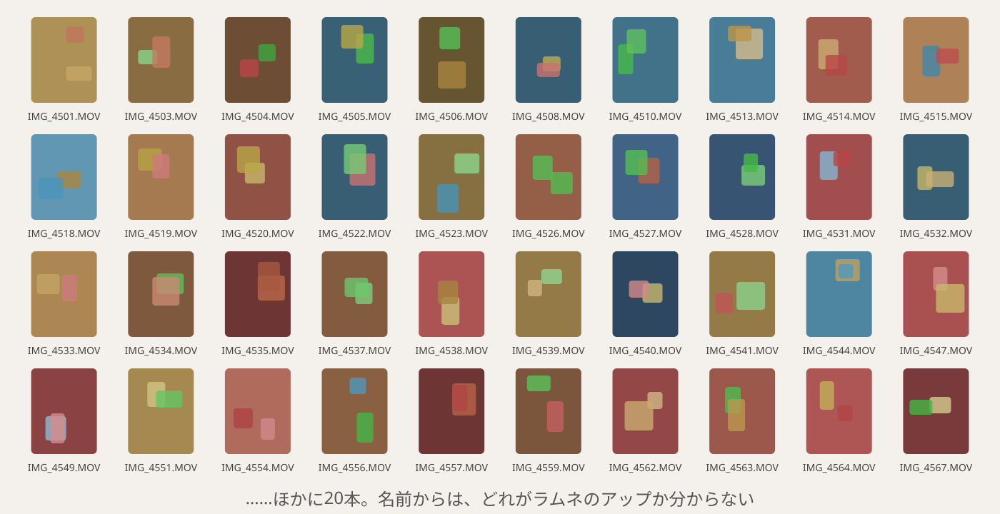
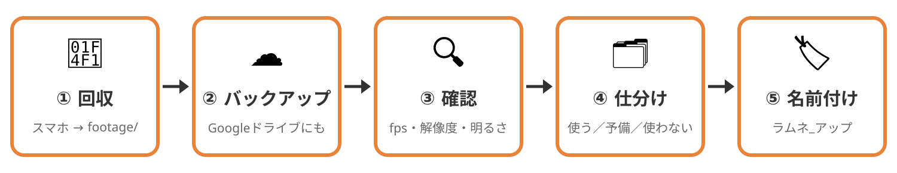
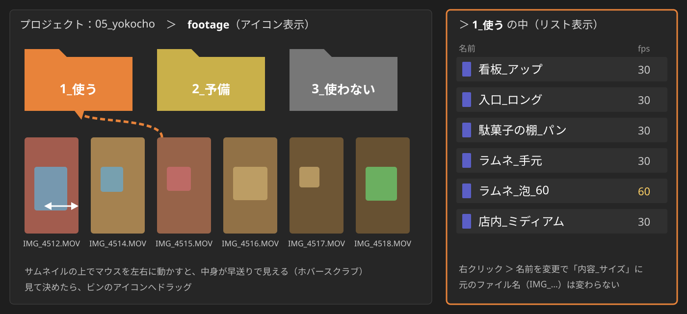
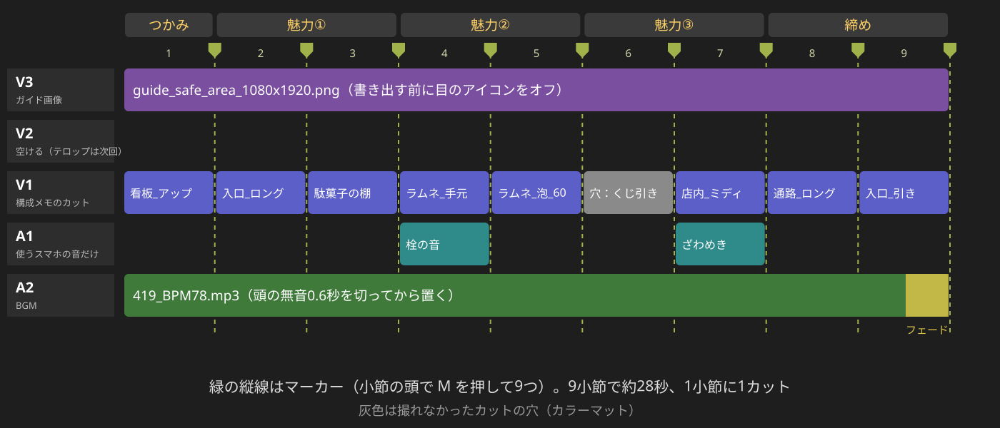
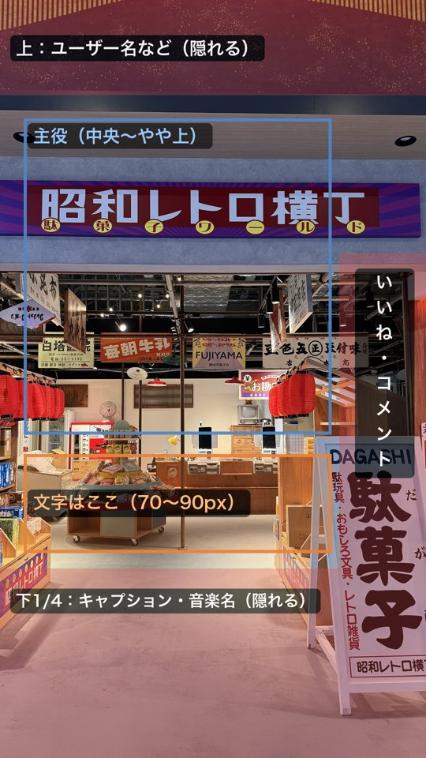
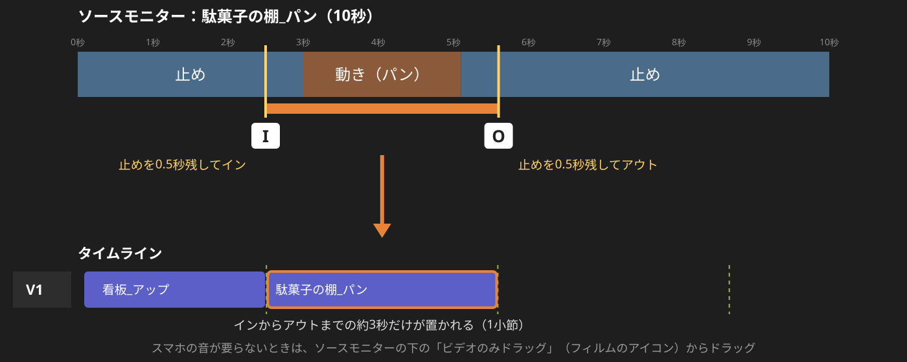
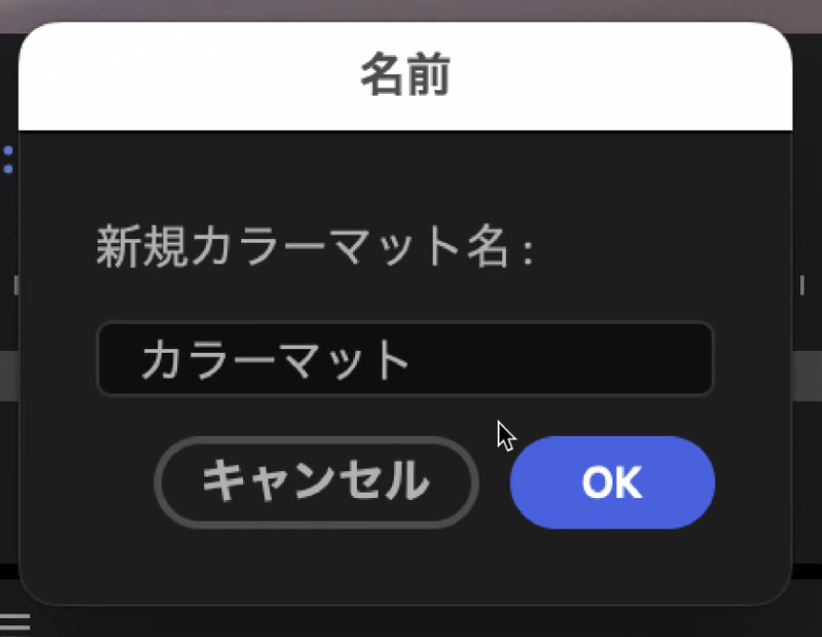
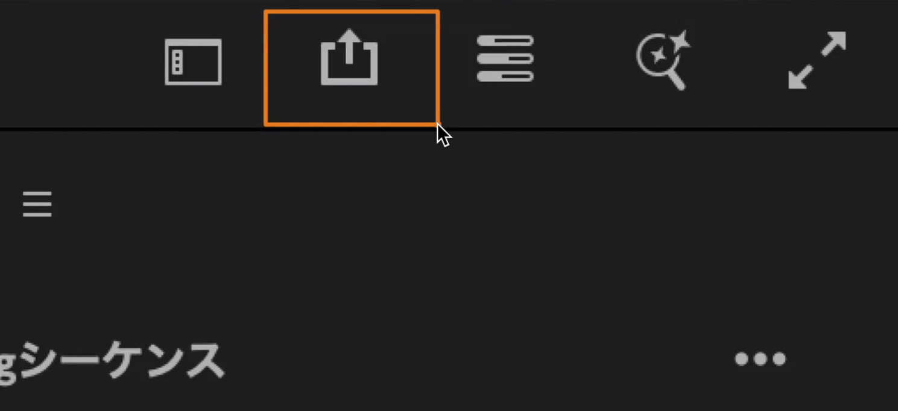

<!-- _class: lead -->
<!-- _paginate: false -->

# 動画基礎 第5回
## 撮った素材を下準備して、粗編集する

2026年10月26日（月）3・4講時
京都芸術デザイン専門学校
キャラクターデザインコース


---

<!-- _class: work -->

# 出席確認のあいだに、作品用のフォルダを作る

```
ドキュメント/動画基礎/
└── 05_yokocho/
    ├── footage/   ← 横丁の素材を全部
    ├── project/   ← Premiereのプロジェクト
    └── export/    ← 書き出した動画
```

1. エクスプローラー（<kbd>Win</kbd>+<kbd>E</kbd>）で「ドキュメント」＞「動画基礎」を開き、新しいフォルダー（<kbd>Ctrl</kbd>+<kbd>Shift</kbd>+<kbd>N</kbd>）で `05_yokocho` を作る
2. `05_yokocho` を開き、中に `footage` `project` `export` の3つを作る（名前は半角英数字）
3. 10/23を休んだ人や、素材がほとんどない人は、**Classroomから素材をダウンロード** して `footage/` に入れる

<!-- 2人に「一番うまく撮れたカット」と「撮れなかったもの」を一言ずつ聞く。「撮れなかった」は、あとの撮れ高チェックの前置きになる。横丁の素材がいまどこにあるか（スマホのまま／もうPCにある／Googleフォトなどにある）を挙手で聞き、回収の進め方を決める。Macの学生は、Finderの「書類」で同じ形を作る（新規フォルダは ⌘+Shift+N） -->

---

# 本日の授業目標

1. **撮影素材を整理し**、使うカットを選ぶ
2. 横丁の魅力と見せる相手を決め、**15〜30秒の構成案** をつくる
3. 構成案に沿って **粗編集** し、通して見られる版を書き出す

---

# 本日の流れ：終わりに、通して見られる版（v1）を提出

| | 3講時 | 4講時 |
|---|---|---|
| やること | 下準備 → 構成メモ → 粗編集の土台を作る | 構成メモの順に並べる → ペアで見る → 直す |
| 終わりに | つかみの1カットが置かれたシーケンス | 約28秒のv1を書き出して提出 |

- 今日決めるのは **並び・長さ・テンポ** だけで、テロップ・色・効果音は次回入れる
- 撮れなかったカットは、穴のまま提出してよい

---

# この中から「ラムネのアップ」を探せますか？



<!-- 講師が横丁で撮った素材（あれば）を IMG_ の番号のまま並べたプロジェクトを映し、学生1人に探してもらう。見つかるまでにかかった時間が、下準備をする理由になる -->

---

<!-- _class: lead -->

# 下準備
## 編集を始める前に、素材を「探さなくていい状態」にする



---

# 下準備は5つで、3講時の前半に全員でやる

| 手順 | やること | しておかないと |
|---|---|---|
| ① 回収 | スマホの横丁の素材を、PCの `05_yokocho/footage/` に全部送る | 素材がスマホとPCに散らばり、編集の途中でカットを探しに行くことになる |
| ② バックアップ | `footage/` をGoogleドライブにもアップロードする | 完成までにPCが壊れると、撮り直しがきかない |
| ③ 確認 | Premiereに読み込み、fps・解像度・明るさを見る | 60fps・4K・HDRが混じっていると、置いたときに大きさや明るさが変わって慌てる |
| ④ 仕分け | 全部見て `1_使う` `2_予備` `3_使わない` のビンに分ける | 粗編集のたびに、60本の中から探すことになる |
| ⑤ 名前付け | `1_使う` のクリップに「内容_サイズ」の名前を付ける | 構成メモにカットを書けず、`IMG_` の番号で覚えることになる |

---

<!-- _class: work -->

# ①② 回収とバックアップ（15分）

1. 横丁で撮った動画を、画質を落とさずに全部 `05_yokocho/footage/` へ送る

| スマホ | 送り方 |
|---|---|
| iPhone | ケーブルでつなぎ、エクスプローラーで `DCIM` の中から `footage` へコピーする（次のページ） |
| Android | ケーブルでつなぎ、スマホの通知で「ファイル転送」を選んで、`DCIM` ＞ `Camera` から `footage` へコピーする |
| ケーブルがない | スマホのGoogleドライブアプリでアップロードし、PCのブラウザでダウンロードして展開する |

2. Googleドライブに `学籍番号_氏名_yokocho` を作って `footage` の中身をアップロードし、終わるのを待たずに次へ進む（ドライブで送った人は、もう済んでいる）

> LINEは画質が落ちるので使わない（Macの人はAirDropでよい）

<!-- フォルダがまだの学生は2ページ目に戻って先に作らせる。Wi-Fiが詰まったら、アップロードは授業の終わりまで続けさせて先に進む。写真も撮っている学生は footage に入れてよい -->

---

# iPhoneをケーブルで送るときは、先に設定を1つ変える

1. iPhoneの **設定 ＞ 写真**（iOS 18以降は **設定 ＞ アプリ ＞ 写真**）のいちばん下で、「MacまたはPCに転送」を **「元のフォーマットのまま」** にする
2. ケーブルでPCにつなぎ、iPhoneのロックを外して、「このコンピュータを信頼しますか？」で **「信頼」** を押す
3. エクスプローラーで **PC ＞ Apple iPhone ＞ Internal Storage ＞ DCIM** を開く
4. `100APPLE` などのフォルダから10/23に撮った動画（`.MOV`）を選び、`footage` にコピーする

- 「自動」のままだと、送るときに形式を変えるので時間がかかり、本数が多いと途中で止まりやすい
- どれが10/23の動画か分からないときは、表示を「詳細」にして日付の列で並べる
- PCで動画のサムネイルが出なくても、Premiereでは読める

<!-- 【要確認】教室の学生PCで、iPhoneの動画（HEVC）がPremiereに読み込めるか。エクスプローラーで日付の列が出るか。DCIMが空に見えるときは、iPhoneのロックが外れているか、「信頼」を押したかを確かめる -->

---

# ファイル名は変えずに、名前はPremiereの中で付ける

- `IMG_` の番号は **撮った順** に並んでいるので、そのままのほうが探しやすい
- 60本の一つひとつに名前を付けると15分では終わらないので、名前は⑤で **「使う」カットにだけ** 付ける
- Premiereでクリップ名を変えても元のファイルは変わらないので、**メディアオフラインにならない**（エクスプローラーでファイル名を変えると、オフラインになる）

> スマホから消すのは、Googleドライブに入ったのを確かめてから

<!-- 第3回の「日付_場所_内容_連番」と違う、と聞かれたら：本数が多いときは、カメラのファイル名を残して編集ソフトの中で名前を付けるやり方がプロの現場でもよく使われる -->

---

<!-- _class: work -->

# ③ 読み込んで、素材の性質を確かめる（5分）

1. 新規プロジェクトを、名前 `05_yokocho`、場所 `05_yokocho/project/` で作る
2. エクスプローラーから `footage` フォルダーをプロジェクトパネルにドラッグすると、同じ名前のビンができる
3. リスト表示にして「フレームレート」と「ビデオ情報」の列を見て、ワークシートの隅にメモする

| 見つけたら | メモすること | あとでどうなる |
|---|---|---|
| 60fps | 本数 | スローに使える |
| 4K（2160×3840） | 本数 | 編集で寄っても画質が落ちにくい |
| 白っぽく、まぶしい | ある／ない | iPhoneのHDRで撮られた素材で、ハンズオンで直す |
| 横で撮ったもの | 本数 | 縦で使うと左右の約7割が切れるので `2_予備` へ |

---

<!-- _class: work -->

# ④ 全部見て、3つのビンに仕分ける（25分）

1. `footage` ビンを開き、中に新規ビンを3つ作る：`1_使う` `2_予備` `3_使わない`
2. アイコン表示にして、パネルの下のスライダーでサムネイルを大きくする
3. サムネイルの上でマウスを左右に動かして中身を見て（ホバースクラブ）、3つのビンのどれかにドラッグする
4. 音はソースモニターでしか確かめられないので、迷ったものだけダブルクリックして再生する

> 1本ずつ最後まで再生していると、25分で終わらない

<!-- 今日いちばん時間をかけるところ。押したときは 1_使う を選ぶところまでにして、予備と使わないの区別はあとでよい -->

---

# ホバースクラブで見て、ビンへドラッグで分ける



---

# 迷ったら、この5つで決める

| 観点 | 見るところ | だめなときの行き先 |
|---|---|---|
| ブレ・ピント | 止めの部分で、主役がはっきり見えるか | ブレが動きの途中だけなら、止めを使う前提で `1_使う` |
| 明るさ | 白く飛んだり、黒くつぶれたりしていないか | 白く飛んだところは戻らないので `3_使わない`、暗いだけなら次回直せるので `2_予備` |
| 長さ | 止め→動き→止めがあるか、前後に1秒の余白があるか | 短くても1秒使えれば `2_予備` |
| 音 | 話し声・笑い声・風が入っていないか | 映像がよければ、音を消す前提で `1_使う` |
| 人 | ほかのお客さんや店員さんの顔が、はっきり分かるか | `3_使わない` |

<!-- 仕分けのあいだは、このページを映したままにする。人の顔の扱いは【要確認】 -->

---

# ⑤ 「使う」に入れたら、すぐ名前を付ける

右クリック ＞ **名前を変更** で、「内容_サイズ」にします

`看板_アップ`　`入口_ロング`　`駄菓子の棚_パン`　`ラムネ_泡_60`（60fpsは `_60` を足す）

- `1_使う` は全体の **3分の1** くらいが目安だが、「この2秒がいい」と言えるカットなら入れてよい
- `3_使わない` のカットも、音だけ・1秒だけ使うことがあるので、ファイルは消さない

### よく見るつまずき
- ビンの中に入ったまま戻れなくなる（第2回の「うっかりビンに入ったときの戻し方」）
- エクスプローラーでファイル名を変えてしまい、メディアオフラインになる

<!-- 早く終わった学生には、1_使う の中を「店の外」「店内」「駄菓子」のようにさらに分けさせる -->

---

<!-- _class: lead -->

# 構成メモ
## 撮った素材から、一番いい28秒を探す

---

<!-- _class: work -->

# 撮れ高チェック（3分）

第4回に書いた **「横丁で撮るカット5つ」** を開き、ワークシートに ○ か × を付けます

| 印 | 意味 | このあと |
|---|---|---|
| ○ | 撮れた | `1_使う` に入っているか確かめる |
| × | 撮れなかった | 構成メモで、別のカットに置き換える |

<!-- 撮り直しはしない前提で組んである【要確認】 -->

---

<!-- _class: hook -->

# 並べる前に、2行だけ決める

## だれに見せて、どう思ってほしい？

相手を決めずに並べると、撮った順に並ぶだけになります

---

<!-- _class: work -->

# 構成メモ① 2行を書く（2分）

```
だれに見せる？　　　（例）二条駅を通る大学生
どう思ってほしい？　（例）「帰りに寄ってみたい」と思って保存する
```

- 第4回は撮る前だったので理想から書いたが、今日は撮り終えているので、`1_使う` の中から一番いい並びを探す
- 次の表の「見せたいもの」は、この2行から逆算する（「寄ってみたい」なら、駄菓子の値段や手に取る手元が効く）

---

<!-- _class: work -->

# 構成メモ② 9小節を、使うカットの名前で埋める（10分）

| ブロック | 小節 | 秒（目安） | 見せたいもの | 使うカット（`1_使う` のクリップ名） |
|---|---|---|---|---|
| つかみ | 1 | 0〜3 | 0秒目で「昭和の横丁だ」と分かるカット | |
| 魅力① | 2 | 3〜9 | | |
| 魅力② | 2 | 9〜15 | | |
| 魅力③ | 2 | 15〜22 | | |
| 締め | 2 | 22〜28 | 入口か看板の引き（店名と場所のテロップは次回） | |

- 1小節（約3秒）に1カットなので、2小節のブロックには2カット入る
- ×だったカットは `2_予備` から代わりを探し、見つからなければ「穴」と書いておく
- 短くしたい人は、魅力を1つ減らして7小節（約22秒）にしてよい

> 最後の2分で、隣の人に2行とつかみのカットを口で説明する

---

<!-- _class: lead -->

# ハンズオン
## 粗編集の土台を作る

A 縦のシーケンス → B BGMとマーカー → C ソースモニターでつかみを置く

AとBは第4回の後編でやった操作の確かめ直しで、Cが今日初めての操作です

---

# 今日のゴール：9小節に9カットを並べる



<!-- 4講時の終わりにこの形になっていれば最低ライン。テロップ（V2）は次回 -->

---

<!-- _class: work -->

# A 縦のシーケンスを作る（5分）

ファイル ＞ 新規 ＞ シーケンス ＞「設定」タブで、次のように決めます

| 項目 | 設定 |
|---|---|
| 編集モード | カスタム |
| タイムベース | 30 フレーム/秒 |
| フレームサイズ | 横 **1080**・縦 **1920** |
| シーケンス名 | `yokocho_rough` |
| カラー ＞ 入力トーンマッピング | **オン**（白っぽいHDRの素材が、ふつうの明るさで見える） |

<!-- 【要確認】教室の版（26.x）での項目名、縦のプリセットの有無、入力トーンマッピングの初期値とソースモニターでの見え方 -->

---



# A セーフエリアのガイドを重ねる

ガイド画像 `guide_safe_area_1080x1920.png` を読み込んで **V3** に置き、**約28秒** まで伸ばします

- 赤いところは、投稿するとアプリの表示に隠れる
- 青に主役、橙に文字を置く

### よく見るつまずき
- 素材を「新規項目」にドラッグして、素材に合わせた大きさ（4Kや横）のシーケンスができる
- ガイド画像を下のトラックに置いて、素材に隠れる

---

<!-- _class: work -->

# B BGMを置き、小節の頭にマーカーを打つ（5分）

1. `419_BPM78.mp3` を **A2** に置く（**A1** はスマホの音のために空ける）
2. 曲の頭の **0.6秒ほどの無音** をトリミングする
3. クリップを何も選ばずに再生し、小節の頭で <kbd>M</kbd> を押して **9つ** 打つ（第4回の後編は10個だった）
4. スナップ <kbd>S</kbd>（磁石）をオンにすると、カットの端がマーカーに吸い付く

- BPM78は4拍（1小節）が **約3.08秒** なので、9小節で約28秒になる
- ずれたマーカーは、右クリック ＞「選択したマーカーを消去」で消して打ち直す

> 今日は全員419を使い、曲を替えたい人は第6回に替える（替えるとカットの切り直しになる）

---

# C 置く前に、ソースモニターで使うところを決める



第2回は丸ごと置いてからあとで切ったが、10秒ある素材は置く前に決めるほうが早い

---

<!-- _class: work -->

# C つかみのカットを置く（10分）

1. 構成メモのつかみのクリップを `1_使う` からダブルクリックすると、左上の **ソースモニター** に開く
2. <kbd>Space</kbd> か <kbd>J</kbd> <kbd>K</kbd> <kbd>L</kbd> で見て、使い始めで <kbd>I</kbd>、使い終わりで <kbd>O</kbd> を押す
3. ソースモニターの画面を、**V1の先頭** へドラッグする（音が要らなければ、下の「ビデオのみドラッグ」から）
4. 「クリップとシーケンスの設定が一致しません」と出たら **「現在の設定を維持」** を選ぶ
5. 4Kの素材は、右クリック ＞ **「フレームサイズに合わせる」** にする（「フレームサイズに合わせてスケール」は、寄ったときに画質が落ちるので選ばない）
6. カットの終わりを、1つ目のマーカーに合わせて詰める

---

# C キーボードでも置ける

再生ヘッドを置きたい位置に合わせ、ソースモニターでインとアウトを打ってから押します

| キー | 置き方 | 第2回のドラッグでいうと |
|---|---|---|
| <kbd>,</kbd>（カンマ）インサート | 再生ヘッドの位置に割り込んで入る | <kbd>⌘</kbd> を押しながらドロップ |
| <kbd>.</kbd>（ピリオド）上書き | 再生ヘッドの位置にあるクリップの上に置く | 普通にドロップ |

- インとアウトはクリップに残るので、もう一度開くと同じ範囲が出てくる
- 止めを0.5秒残して打つ（第3回で撮った「止め」が、ここで切りどころになる）
- 挑戦：インとアウトを打ってから右クリック ＞ **サブクリップを作成** で、1本を `ラムネ_手元` と `ラムネ_泡` に分ける

### よく見るつまずき
- プログラムモニター（右）でIとOを押して、シーケンスのほうにインとアウトが付く

<!-- , や . で思ったトラックに入らないときは、タイムラインの左のソースのパッチ（V1・A1の印）を確かめる。【要確認】教室のキーボードでの , . の位置と、パッチをどこまで説明するか -->

---

<!-- _class: lead -->

# 休み時間の前に <kbd>⌘</kbd>+<kbd>S</kbd>

Googleドライブのアップロードが終わったか確かめよう
終わっていなければ、そのまま4講時も続ける

---

<!-- _class: lead -->

# 4講時　粗編集
## 構成メモの順に並べて、通して見られる版を作る

---

# 4講時の流れ：決めるのは並び・長さ・テンポだけ

| 時間 | やること |
|---|---|
| 0:00〜0:05 | 進め方と、カラーマットの穴 |
| 0:05〜0:45 | **制作①** 構成メモの順に並べる |
| 0:45〜0:52 | ペアで通して見せ合う |
| 0:52〜0:55 | 書き出しの手順 |
| 0:55〜1:15 | **制作②** 直して書き出し → **提出** |
| 1:15〜1:22 | v1の上映、次回の予告 |
| 1:22〜1:30 | まとめ・理解度クイズ・振り返りシート |

テロップ・色・効果音は次回入れるので、今日は入れなくてよい

---

# まず最低ラインで書き出してから、標準・挑戦へ

| 段階 | 入っているもの |
|---|---|
| 最低ライン | 9小節（約28秒）が埋まっている（×のカットはカラーマットの穴でよい）、BGMの終わりがフェード、1080×1920で書き出して提出 |
| 標準 | 0秒目から横丁と分かるつかみ、カットの切り替わりが小節の頭にそろっている、要らないスマホの音が消えている |
| 挑戦 | 60fpsのカットをスローにする（速度・デュレーションで50%）、同じ被写体をロング→アップの順につなぐ、×のカットを穴のままにせず別の方法で埋める |

<!-- 制作のあいだは、このページを映したままにする。BGMの終わりのフェードは第2回のコンスタントパワー -->

---

# 撮れなかったカットは、カラーマットの穴で残す

  

プロジェクトパネル ＞ **新規項目 ＞ カラーマット** で灰色を作り、名前を **「穴：くじ引きのアップ」** のようにして、その小節に置きます

- クリップ名がタイムラインに出るので、文字ツールを使わなくても何が足りないかが分かる
- 無理に別のカットで埋めると何が足りなかったのかが見えなくなるので、v1では穴を残してよい

---

<!-- _class: work -->

# 制作① 構成メモの順に並べる（40分）

構成メモの上から順に、ソースモニターでインとアウトを打って並べます

手が止まったら、この4つを確かめよう

| 気づいたこと | 直し方 |
|---|---|
| 10秒の素材をそのまま置いている | ソースモニターでインとアウトを打ち直す |
| 撮った順に並んでいる | 「最初の1秒で指を止めさせるカットはどれ？」と考えて、つかみを選び直す |
| 要らないスマホの音が残っている | 右クリック ＞「有効」のチェックを外すか、ビデオのみで置き直す |
| 横で撮ったカットで、上下が黒い | `2_予備` から差し替える |

<!-- 講師は巡回し、全体に話すのは15分ごろの1回だけ（多かったつまずきを1分で）。3講時のハンズオンで遅れた学生は、マーカーが9つそろっているかを最初に見る -->

---

<!-- _class: work -->

# ペアで通して見せ合う（7分）

隣の人とBGMつきで通して再生し合い、次の3つを相手に伝えます

1. 0秒目で、昭和の横丁だと分かった？
2. 長くて間延びしたカットはどれ？
3. 構成メモの2行（だれに・どう思ってほしいか）を見せてもらって、そう見えた？

言われたことは、ワークシートの裏にメモしておく

---

# 書き出しの手順

1. ガイド画像のトラック（V3）の **目のアイコンをオフ** にする（忘れると色の帯ごと書き出される）
2. `yokocho_rough` を選んで書き出し：**H.264**、**ソースに一致（アダプティブ高ビットレート）**
3. 概要の欄で **1080×1920** になっているか確かめる
4. 保存先は `05_yokocho/export/`、ファイル名は `学籍番号_氏名_05rough.mp4`

 

<!-- 第4回の後編で一度書き出している。第4回の提出にガイド画像が映り込んだものがあれば、ここで例として見せる。書き出せたらスマホに送って縦で再生させる（時間がなければ次回でよい） -->

---

# 提出のルール

| 項目 | 内容 |
|---|---|
| ファイル名 | `学籍番号_氏名_05rough.mp4` |
| 保存先 | `05_yokocho/export/` |
| 提出先 | Classroom「第5回 粗編集」 |
| 締切 | **4講時の残り15分** |
| コメント欄 | 構成メモの2行（だれに・どう思ってほしいか）、Googleドライブの素材フォルダのURL |

> 穴が残っていても、9小節を通して見られれば提出してかまいません

<!-- 締切は4講時の1:15。教室の時計の時刻を板書する。提出のあと、2〜3人のv1をプロジェクターで流し、ペアの3つの観点で講師がひと言ずつ返す -->

---

<!-- _class: lead -->

# まとめ

---

# 本日のまとめ

### 下準備
- 回収 → バックアップ → 確認 → 仕分け → 名前付けで、素材を **探さなくていい状態** にしてから切り始める

### 構成と粗編集
- 並べる前に、**だれに見せて、どう思ってほしいか** を決める
- ソースモニターで **使うところだけ** を置き、粗編集では **並び・長さ・テンポ** だけを決める
- 撮れなかったカットは、カラーマットの穴で残しておく

---

# 次回の授業

## 第6回：テロップ・音・色で仕上げる

- テロップと音を、設定値まで詰める（第4回の前編でできなかったところ）
- 色で、昭和らしさを出す
- 途中で講評をする

### 持ち物
- PC
- イヤホン（音を作る）
- スマホ（書き出した動画を縦で見る）

> 今日の `05_yokocho` フォルダは、消さずにそのまま使います

<!-- 【要確認】次回の日付と内容。yokocho_rough を複製して使う -->

---

<!-- _class: lead -->

# 理解度クイズ

Classroomの理解度クイズ（3問）

---

<!-- _class: lead -->

# 振り返りシート記入

## 本日の行動目標

1. 撮影素材を整理し、使うカットを選ぶ
2. 横丁の魅力と見せる相手を決め、15〜30秒の構成案をつくる
3. 構成案に沿って粗編集し、通して見られる版を書き出す
