<!-- _class: lead -->
<!-- _paginate: false -->

# 動画基礎 第6回
## テロップ・音・動きを試して、作品の曲を探す

2026年11月6日（金）1・2講時
京都芸術デザイン専門学校
キャラクターデザインコース

---

<!-- _class: work -->

# 出席確認のあいだに、復習クイズをやって横丁見本を開く

1. Classroom の **復習クイズ** をやる（第5回の内容、5問）
2. Classroom の **横丁見本のPremiere版（zip）** をダウンロードして展開する
3. 中の `yokocho_ハンズオン用.prproj` を開く
4. 「メディアをリンク」の画面が出たら **検索** を押し、展開したフォルダの中から同じ名前のファイルを選ぶ
5. シーケンス `横丁_ハンズオン用` をダブルクリックして開く

<!-- 復習クイズは復習クイズ_第5回.md。答え合わせは口頭で短くし、Q2は次のページの「v1の並びは直さなくてよい」につなげる。素材の場所は講師のMacのパスで保存してあるので、学生のPCではメディアをリンクの画面が出る。1つ選ぶと残りも見つかるはずだが、footage・graphics・audio のフォルダごとに聞かれたら同じように選ばせる。【要確認】Windowsで開いたときの画面の項目名。第4回のハンズオンができなかった学生が多いので、ここで止まる学生を先に見に行く。先に開けた学生に隣を手伝わせる -->

---

# 絵コンテを待つあいだに操作と曲をそろえる

| 回 | 日付 | 内容 |
|---|---|---|
| **第6回（今日）** | 11/6 | ハンズオン、作品の曲探し |
| 第7回 | 11/13 | 絵コンテをもとに編集し直し、テロップ・音・色で仕上げる、途中講評 |
| 第8回 | 11/20 | 完成、上映、納品 |

- 絵コンテができるまで、v1の並びは直さなくてよい
- 今日そろえた操作と曲は、絵コンテができた日にそのまま使える

<!-- 第5回の「次回の授業」では、テロップ・音・色で仕上げて途中講評をすると予告していたので、その訂正を一言。【要確認】第7回に絵コンテがそろうか -->

---

# 本日の授業目標

1. **テロップ・音・動き** を、横丁見本の素材で試す
2. 利用条件を確かめて、**作品に使う曲** を選ぶ
3. 曲の **1小節の長さ** を測り、カットの長さの目安にする

---

# 本日の流れ：1コマにつき1つ提出する

| | 1講時 | 2講時 |
|---|---|---|
| 素材 | **横丁見本の素材**（全員同じ） | **自分の素材**（`05_yokocho`） |
| やること | ハンズオン ①テロップ → ②音 → ③動き | 曲を探し、1曲に決めてv1にあてる |
| 終わりに | 12秒の練習版を書き出して提出 | 曲カードを提出 |

- **曲カード** は本日の納品物で、作品に使う曲の曲名・作者・URL・利用条件・1小節の長さ・選んだ理由をまとめたもの
- 1講時は全員が同じ素材なので、**見本と同じになれば合っている**
- 先に終わった人は隣の人の画面を見て、止まっていたら手伝ってください

---

<!-- _class: lead -->

# 1講時　ハンズオン

①テロップ → ②音 → ③動き → 書き出し

キーはWindowsの表記で、Macの人は Ctrl を ⌘、Alt を option に読み替えます

---

# ハンズオンのチェック

| ブロック | 時間 | 置いてあるもの | 今日やること |
|---|---|---|---|
| 1 | 00:00〜03:02 | 入口の写真（V1）、ステッカー（V2） | ①テロップ、③A・B |
| 2 | 03:02〜06:05 | ホーロー看板（V1）、帯2本（V2・V3） | ③C、ブロック1との境目に③D |
| 3 | 06:05〜09:07 | 黒電話とミゼット（V1） | ①テロップの使い回し、③D |
| 4 | 09:07〜12:09 | クリーム（V1）、ロゴ（V2） | ③E（挑戦） |

- 時間は「秒:フレーム」で、30フレームで1秒
- BGMは最初からA1に置いてあり、ガイド画像はプロジェクトパネルに入っている
- 手順ごとの見本動画は、展開したフォルダの `見本` に入っている

---

<!-- _class: work -->

# ハンズオン① テロップを入れる（20分）

1. ガイド画像 `guide_safe_area_1080x1920.png` をV3の上の空いたところへドラッグし、12秒まで伸ばす
2. 再生ヘッドを 00:00 に置き、横書き文字ツール <kbd>T</kbd> でプログラムモニターをクリックして、2行で打つ
   **京都・二条の／昭和レトロ横丁**
3. プロパティパネルで、フォント・サイズ・色・境界線を次のページの目安に合わせる
4. 選択ツール <kbd>V</kbd> に戻して文字を橙の帯へ動かし、クリップの終わりを 03:02 に詰める
5. <kbd>Alt</kbd> を押しながら文字のクリップを 06:05 へドラッグして複製し、09:07 まで伸ばして **昭和の街並みが／そのまま** に打ち替える

> ブロック2は帯が文字の場所を使っているので、テロップはブロック3に置く

<!-- 文字のクリップはどのトラックに入ってもよい。ガイド画像より下に入っても、色が薄くかかるだけで作業に支障はない。第4回のスライドはコピーと貼り付けだったが、貼り付けはターゲットのトラックに入り、V1の写真の上に貼られることがあるので、Altを押しながらのドラッグにした -->

---

# ① テロップの設定の目安

| 項目 | 目安 | 理由 |
|---|---|---|
| フォント | 源ノ角ゴシック JP の Bold など、太めのゴシック | スマホの小さい画面でも潰れない |
| サイズ | **70〜90px** | 1080の幅に、1行10文字前後が収まる |
| 行数 | 1行10文字前後、2行まで | 右端のアイコンを避けて収まる |
| 色 | 白い文字に黒の境界線（6〜10px）、または背景つき | 明るいカットでも暗いカットでも読める |
| 位置 | ガイドの「文字はここ」の帯 | 下はキャプション、右端はアイコンに隠れる |
| 表示時間 | 2秒以上、文字数÷4 秒が目安 | 1秒に4文字が読める速さ |

---

<!-- _class: m -->

# ① ガイドの橙の帯に収まっていれば、投稿しても隠れない

見本

<video class="mihon" src="videos/mihon_01.mp4" poster="images/mihon_01.jpg" controls playsinline preload="metadata"></video>

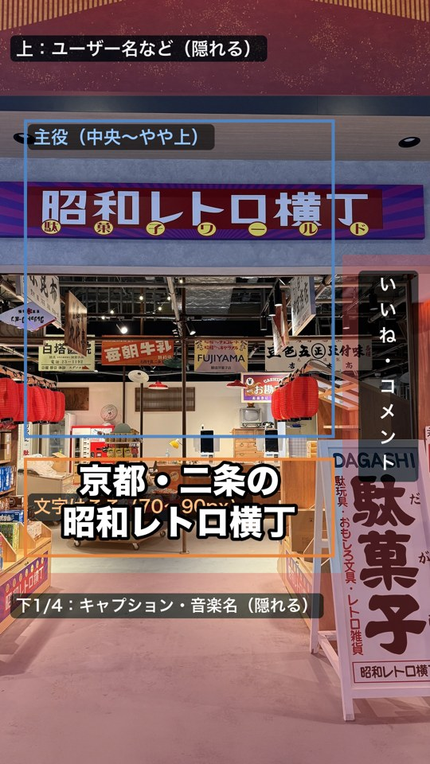 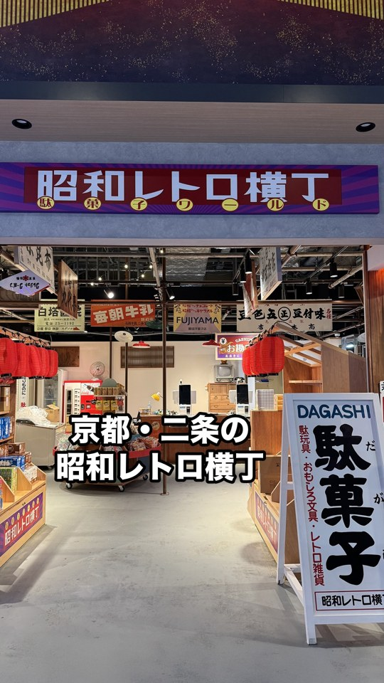

右はガイドを消したところで、大きさと位置はここで見比べて決める

---

# ① 文字ツールとプロパティパネル

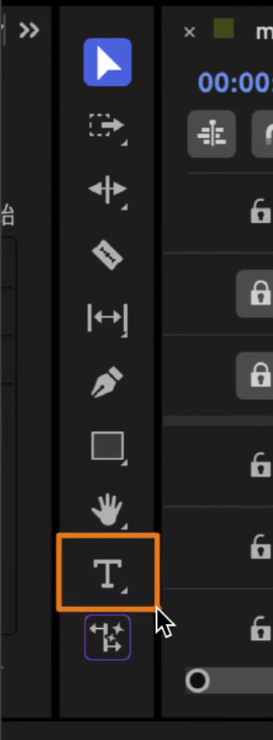 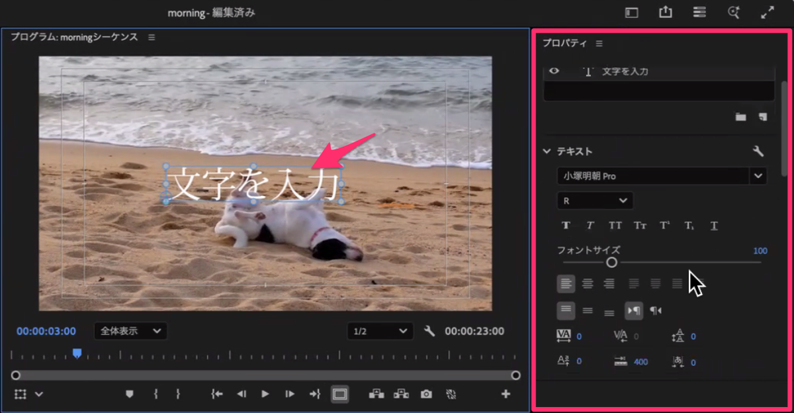

<kbd>T</kbd> でプログラムモニターをクリックして打ち、右のプロパティパネルで整える

---

# ① 境界線・背景・使い回し

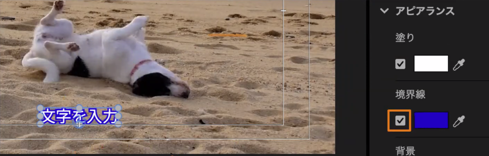 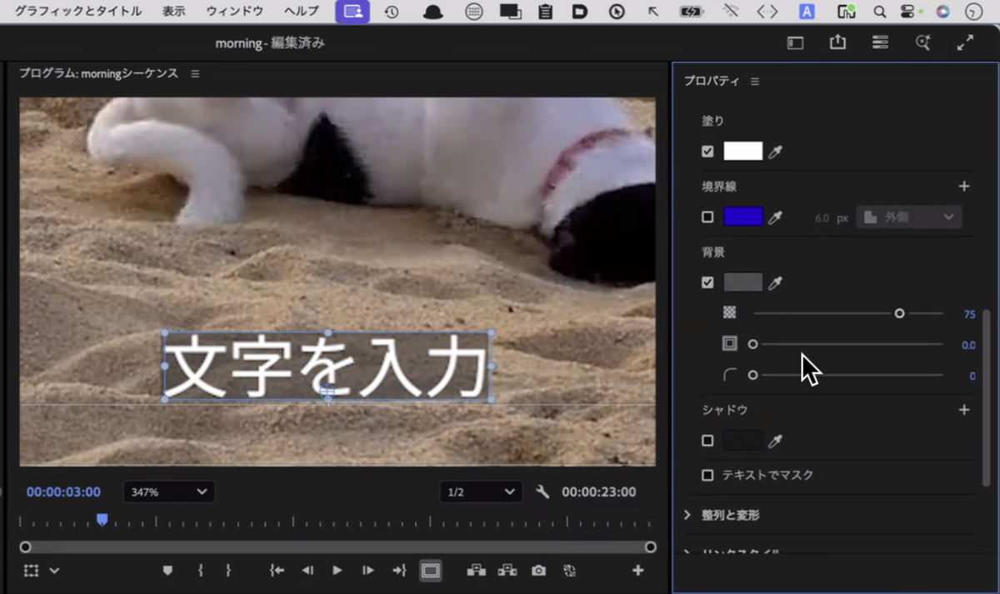

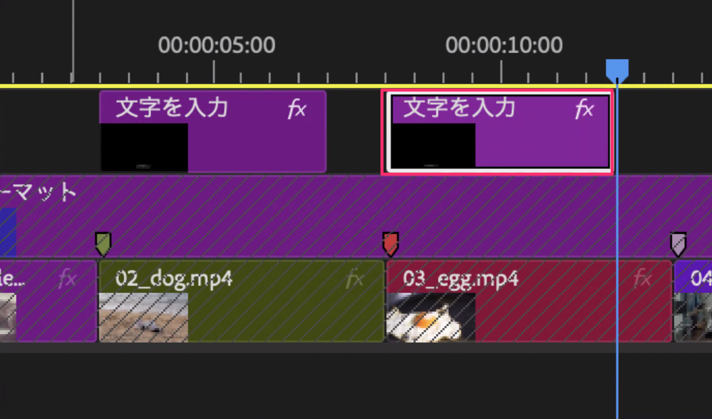

コピーと貼り付けでもよいが、写真の上に貼られたら <kbd>Ctrl</kbd>+<kbd>Z</kbd> で戻して、<kbd>Alt</kbd>+ドラッグで複製する

<!-- 背景を色付きにするとステッカー風になる。項目名は教室の版で【要確認】 -->

---

<!-- _class: work m -->

# ハンズオン② 音を仕上げる（15分）

見本

<video class="mihon" src="videos/mihon_02.mp4" poster="images/mihon_02.jpg" controls playsinline preload="metadata"></video>

1. BGM（A1）を選び、エフェクトコントロール ＞ オーディオ ＞ ボリューム ＞ **レベル** を開く
2. 再生してオーディオメーターを見て、ピークが **-6** を超えないようにレベルを決める（-6〜-12dB あたり）
3. エフェクト ＞ オーディオトランジション ＞ クロスフェード ＞ **コンスタントパワー** をBGMの終わりに置き、ダブルクリックして **1秒** にする
4. 展開したフォルダの `audio/se_ポン.wav` を読み込む
5. 効果音を、ブロック3のテロップが出る瞬間（06:05）の **A2** に置き、BGMに埋もれない大きさにする

> 自分の作品のトラックは、A1 スマホの音、A2 BGM、A3 効果音にして、効果音は30秒で4か所までにする

<!-- 見本のシーケンスにはスマホの音がないのでBGMがA1に入っている。効果音は授業用に合成した音で、権利の確認は要らない。【要確認】A1のレベルの初期値（build_premiere.py では -6dB） -->

---

# ② フェードと音量

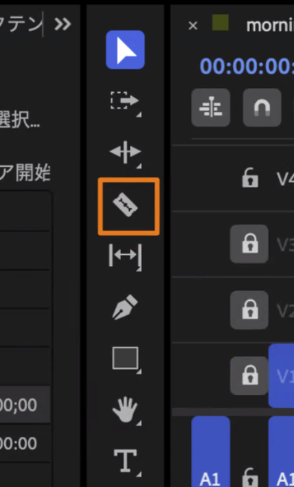 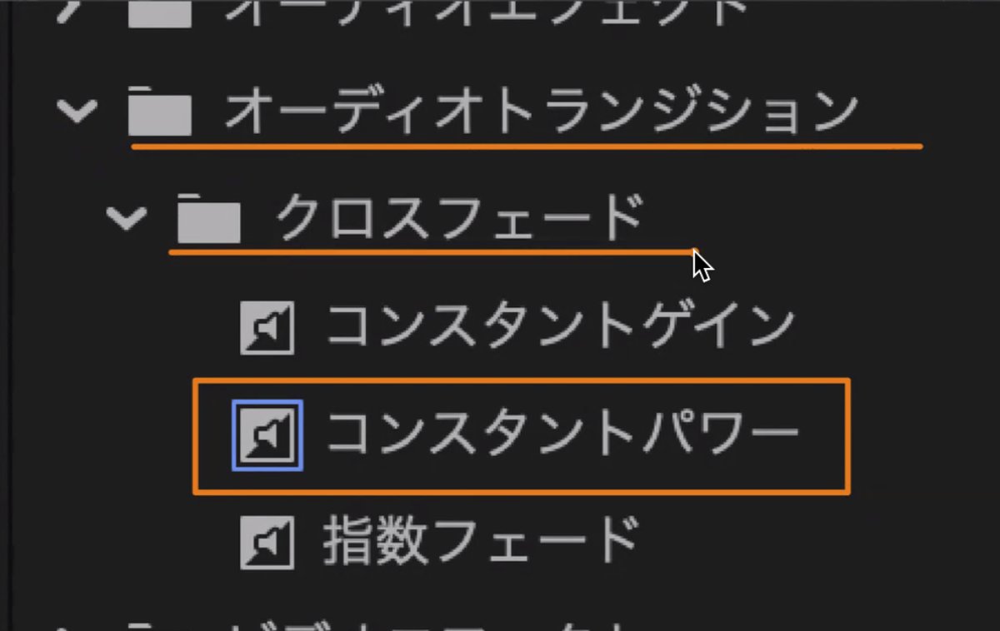 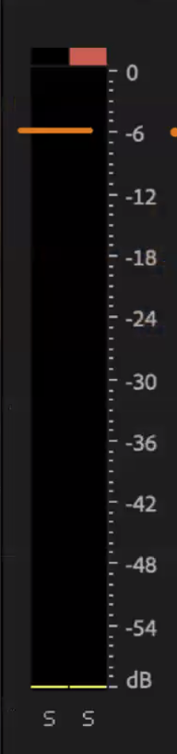

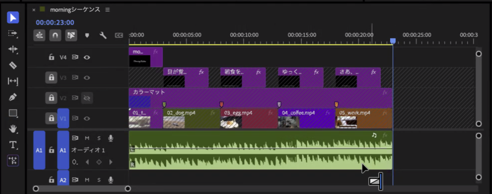 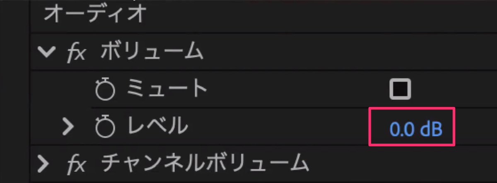

<!-- BGMを途中で切るときはレーザー C。今日のシーケンスはBGMが終わりで切ってあるので、切らなくてよい -->

---

<!-- _class: hook -->

# 横丁の音は、 効果音より強く場所を伝える

## 店のざわめき・物を置く音・ラムネの栓

自分の作品では、録れている音をBGMの下に薄く敷こう（`3_使わない` のカットから音だけ使ってもよい）

---

<!-- _class: lead -->

# ハンズオン③ 動きを再現する（28分）

A ズームパンチ／B ステッカー／C 帯／D フラッシュと円形ワイプ／E（挑戦）ロゴ

派手に見える動きも、部品を重ねて **キーフレーム** で動かしているだけです

<!-- 最初の2分で、完成形のプロジェクト yokocho_完成形.prproj を講師の画面で開いて15本のトラックを見せる。完成形は別のプロジェクトなので、学生は開かなくてよい -->

---

# キーフレームを打つ場所への移り方

- クリップの頭へは、タイムラインで <kbd>↑</kbd> <kbd>↓</kbd> を押すと編集点ごとに移れる
- 何フレームか進めるときは、左上の時間表示をクリックして **`+11`** と打って <kbd>Enter</kbd>
- 1フレームずつなら <kbd>→</kbd>
- エフェクトコントロールの項目の左の **ストップウォッチ** を押すと1つ目が打たれ、そのあとは再生ヘッドを動かして値を変えるだけで増えていく

どの課題も「クリップの頭で1つ目、そこから何フレーム後に2つ目」という形にしてある

---

<!-- _class: work m -->

# A 写真にズームパンチ（6分）

見本

<video class="mihon" src="videos/mihon_03a.mp4" poster="images/mihon_03a.jpg" controls playsinline preload="metadata"></video>

1. ブロック1の入口の写真（V1）を選び、エフェクトコントロールの「モーション」を開く
2. クリップの頭（00:00）で、スケールのストップウォッチを押す（**100**）
3. `+11`（00:11）で **118**
4. 終わりの1フレーム前（03:01）で **122**

最初の11フレームで一気に寄り、残りの3秒でじわじわ迫る

> 自分の作品では：1080pの素材は大きく寄ると粗くなるので、スマホで見て確かめる

---

<!-- _class: work m -->

# B ステッカーをポンと出す（7分）

見本

<video class="mihon" src="videos/mihon_03b.mp4" poster="images/mihon_03b.jpg" controls playsinline preload="metadata"></video>

1. ステッカー「関西最大級！」（V2）を選び、クリップの頭（00:21）へ
2. スケール **60** と不透明度 **0** で、それぞれストップウォッチを押す
3. `+8`（00:29）でスケール **105**、不透明度 **100**
4. `+5`（01:04）でスケール **100**

105%まで行き過ぎてから戻すので、ポンと弾んで見える

> 自分の作品では：①のテロップに同じキーフレームを打つと、文字がポンと出る

---

<!-- _class: work m -->

# C 帯を左右から入れる（6分）

見本

<video class="mihon" src="videos/mihon_03c.mp4" poster="images/mihon_03c.jpg" controls playsinline preload="metadata"></video>

1. 帯「昭和30〜50年代」（V2）の頭（03:11）で、位置のストップウォッチを押し、X を **-540**
2. `+14`（03:25）で X を **540**
3. 2つ目のキーフレームを右クリック ＞ 時間補間法 ＞ **イーズイン**
4. 帯「映画セット風」（V3）の頭（03:20）でも同じようにし、右から入れるので X を **1620** から始めて、`+14`（04:04）で 540

帯の幅は画面と同じ1080なので、中心を1080ずらすと画面の外に隠れる

---

<!-- _class: work m -->

# D フラッシュと円形ワイプ（5分）

見本

<video class="mihon" src="videos/mihon_03d.mp4" poster="images/mihon_03d.jpg" controls playsinline preload="metadata"></video>

1. エフェクトパネルの検索欄に「ホワイトアウト」と打ち、ディゾルブの中の **ホワイトアウト** を、ブロック1と2の境目（03:02）にドラッグ
2. ダブルクリックして、デュレーションを **6フレーム** にする
3. 検索欄に「アイリス」と打ち、**アイリス (円形)** を黒電話とミゼットの境目（07:12）に置いて **12フレーム**

- 「ホワイトアウト (レガシー)」は古い版なので使わない
- 26.0 で名前と場所が変わったので、**検索欄で探す** のがいちばん早い

> 自分の作品では：全部のつなぎ目に付けず、場面が変わる1〜2か所にする

<!-- 動画のカットでは、前後1秒の余白がないとトランジションで同じコマが繰り返される。【要確認：教室の版での表示】 -->

---

<!-- _class: m -->

# E（挑戦）ロゴを落として弾ませる

見本

<video class="mihon" src="videos/mihon_03e.mp4" poster="images/mihon_03e.jpg" controls playsinline preload="metadata"></video>

ロゴ（V2）の位置の **Y** に、キーフレームを4つ打つ（X は 540 のまま）

| 時間 | 位置のY | 何が起きているか |
|---|---|---|
| 09:10（頭） | -480 | 画面の上の外 |
| 09:20（+10） | 840 | 着地（少し下まで行く） |
| 09:24（+4） | 790 | 跳ね返る |
| 09:28（+4） | 820 | 止まる |

着地のときにスケールを 104→97→100 と動かすと、つぶれて戻るように見える

---

<!-- _class: m -->

# 完成形で答え合わせ：見本と同じ動きになった？

見本

<video class="mihon" src="videos/mihon_00.mp4" poster="images/mihon_00.jpg" controls playsinline preload="metadata"></video>

| 課題 | 時間 | 値 |
|---|---|---|
| A | 00:00〜03:01 | スケール 100 → 118 → 122 |
| B | 00:21〜01:04 | スケール 60 → 105 → 100、不透明度 0 → 100 |
| C | 03:11〜04:04 | 位置X -540 → 540、1620 → 540 |
| D | 03:02、07:12 | ホワイトアウト 6フレーム、アイリス (円形) 12フレーム |
| E | 09:10〜09:28 | 位置Y -480 → 840 → 790 → 820 |

ほかの動き（1文字ずつ跳ねる文字など）は、`動画基礎 第4回リンク集.pdf` から調べられる

---

# 速度のデモ：スローにするなら60fpsの素材を使う

`30fps.mp4` と `60fps.mp4` を並べて、どちらも速度・デュレーションで **50%** にする

| 撮ったときの fps | 50% にすると |
|---|---|
| 30fps | 同じコマが2回ずつになって、**カクカク** する |
| 60fps | 50%まで **なめらか** |

> 自分の作品では：名前に `_60` を付けたクリップが、スローに使える

<!-- 講師だけのデモ（3分）。PremierePro/01_fps/ の2本。押したら省く -->

---

<!-- _class: work -->

# 書き出して、スマホの縦で確かめる（7分）

1. ガイド画像のトラックの **目のアイコンをオフ** にする（忘れると色の帯ごと書き出される）
2. `横丁_ハンズオン用` を選んで書き出し：**H.264**、**ソースに一致（アダプティブ高ビットレート）**
3. 概要の欄で **1080×1920** になっているか確かめる
4. 保存先は `05_yokocho/export/`、ファイル名は `学籍番号_氏名_06handson.mp4`
5. 自分のスマホに送って縦で再生し、テロップの大きさと位置を **スマホで** 見る
6. Classroom「第6週資料」に提出する（途中まででもよい）

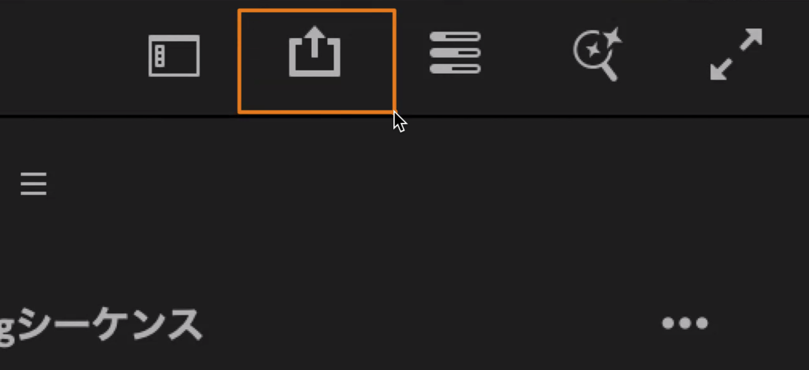 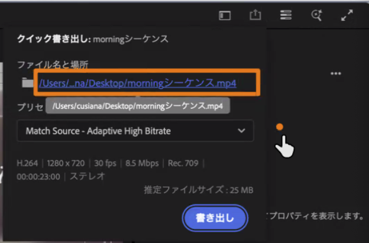

---

# 1講時のまとめ：3つの操作は、第7回に自分の作品で使う

| 操作 | 第7回に自分の作品ですること |
|---|---|
| ① テロップ | 店名・場所・ひとことを、橙の帯に入れる |
| ② 音 | 曲の音量とフェードを整え、効果音を4か所まで足し、横丁の音を薄く敷く |
| ③ 動き | ズームパンチ、ポン、帯などから、1つか2つに絞って使う |

絵コンテができるまでは、自分の `yokocho_rough` にテロップを入れなくてよい（カットの順番が変わると作り直しになる）

ほかの動きや切り替えは、<a href="?deck=decks/movie/camerawork/camerawork_transition.md" target="_blank">カメラワークとトランジション一覧</a> で動きを見ながら調べられる

---

<!-- _class: lead -->

# 休み時間の前に <kbd>Ctrl</kbd>+<kbd>S</kbd>

横丁見本のプロジェクトを保存してから休憩
2講時は、イヤホンと `05_yokocho` のプロジェクトを用意して待っていてください

---

<!-- _class: lead -->

# 2講時　曲探し
## 曲で、作品の印象とカットの長さが決まる

---

# 2講時の流れ：1曲を決めて、曲カードを出す

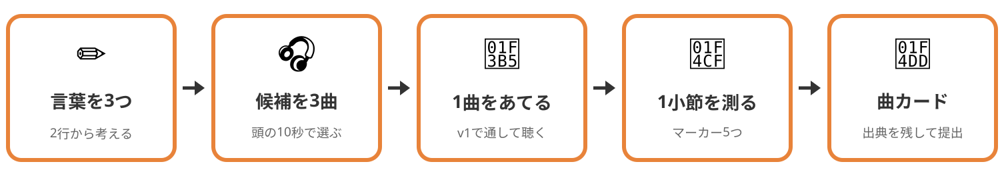

| 時間 | やること |
|---|---|
| 0:00〜0:15 | 曲で変わること、使える曲のルール |
| 0:15〜0:55 | **探す言葉を3つ書き、候補を3曲見つける** |
| 0:55〜1:20 | **1曲に決めてv1にあて、1小節を測り、曲カードを提出** |
| 1:20〜1:30 | 2〜3人の曲を聴く、まとめ・理解度クイズ・振り返りシート |

---

<!-- _class: hook -->

# 同じ映像でも、 曲を替えると別の動画になる

## どの曲で、横丁に寄ってみたくなった？

同じ30秒に3つの曲をあてて流すので、見終わったら挙手で答えてください

<figure><video src="videos/song_a.mp4" poster="images/song_poster.jpg" controls playsinline preload="metadata"></video><figcaption><b>A 駄菓子を選ぶわくわく</b> かえるのピアノ（こおろぎ）</figcaption></figure><figure><video src="videos/song_b.mp4" poster="images/song_poster.jpg" controls playsinline preload="metadata"></video><figcaption><b>B 映画のセットのような通り</b> わくわくクッキングタイム的なBGM（鷹尾まさき）</figcaption></figure><figure><video src="videos/song_c.mp4" poster="images/song_poster.jpg" controls playsinline preload="metadata"></video><figcaption><b>C 帰り道のようなしみじみ</b> 10℃（しゃろう）</figcaption></figure>

---

# 曲は、カットの長さも決める

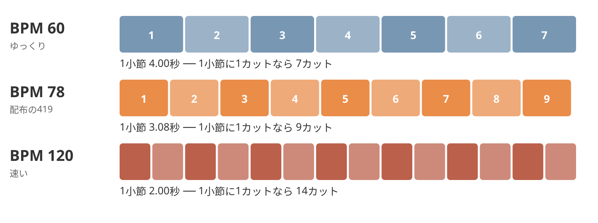

テンポが速い曲ほど1小節が短くなるので、曲を替えると28秒に入るカットの数が変わる

---

# 昭和の名曲は、ほとんどがまだ使えない

- 作詞・作曲の権利は **作者の死後70年** 続くので、昭和の歌謡曲の多くは保護されたままになっている
- CDや配信の音源には、別に **録音した会社などの権利** がある
- 自分で歌うカバーでも、作詞・作曲の権利は残る
- InstagramやTikTokのアプリ内の人気曲は個人の投稿向けで、**お店の宣伝の投稿には使えない**（第1回のクイズ①の続き）

> だから、作者が「使ってよい」と条件を示している曲を探すか、AIで作る

<!-- 出典（2026-11-05確認）：Metaの音楽ガイドライン https://www.facebook.com/legal/music_guidelines は商用や個人的でない目的の利用を、適切なライセンスがない限り禁止している。TikTokは商用の投稿に Commercial Music Library を案内している https://support.tiktok.com/en/business-and-creator/creator-and-business-accounts/commercial-use-of-music-on-tiktok 。どちらもアプリの中で使う曲なので、納品するmp4には入れられない -->

---

# 曲は、4つのサイトで探すか、AIで作る

| サイト | 商用利用 | クレジット | 短く切る | 探す入口 |
|---|---|---|---|---|
| [OpenTracks（旧DOVA-SYNDROME）](https://opentracks.com/bgm/category/nostalgic/) | ○ | 不要 | ○ | タグ「懐かしい」だけで3,605件、[AI検索 β](https://opentracks.com/bgm/ai-search) |
| [BGMer](https://bgmer.net/) | ○ | 任意 | ○ | タグとジャンル |
| [甘茶の音楽工房](https://amachamusic.chagasi.com/) | ○ | 任意 | ○ | イメージ別、ジャンル別 |
| [魔王魂](https://maou.audio/) | ○ | **必要**（音楽：魔王魂） | ○ | BGM、旧ゲーム音楽 |

- AIで作るなら、商用利用できる Adobe Firefly の [音楽を生成](https://www.adobe.com/jp/products/firefly/features/ai-music-generator.html) を使い（歌なしのBGM向け）、商用利用できない Sunoの無料プランは使わない
- 第1回のリストにあったYouTubeオーディオライブラリは、公式ヘルプにYouTubeの動画で使う説明しかないので、今回は使わない
- 規約は変わることがあるので、曲を保存する日や作る日に自分でも読む

<!-- 規約の出典：https://opentracks.com/help/articles/license/ 、https://bgmer.net/terms/ 、https://amachamusic.chagasi.com/terms.html 、https://maou.audio/rule/ 。OpenTracksは「イントロをカットする、必要部分のみを切り出して」を加工の例に挙げている。お店が自分のSNSに投稿することは、4サイトとも明記がない【要確認：投稿の予定】。AIは2026-11-06に確認：Fireflyは「安全に商用利用できます」と明記 https://www.adobe.com/jp/products/firefly/features/ai-music-generator.html で、無料アカウントでも毎日の無料生成枠で使えるが、無料枠の商用利用を明示した文はない。Sunoは料金ページに無料は No commercial rights、規約に personal and non-commercial とある https://suno.com/pricing 、https://suno.com/terms -->

---

# 保存する前に、3つを確かめる

| 確かめること | 見るところ | 理由 |
|---|---|---|
| 商用利用 | サイトの利用規約 | 横丁の動画は、お店の宣伝になる |
| クレジット | サイトの利用規約 | 必要なサイトの曲は、動画の説明文とクレジット一覧に書く |
| 作曲者の利用条件 | OpenTracksの曲のページ | サイトの規約より、作曲者の条件が優先される |

- どれか1つでも分からないときは、その曲をやめて次を探す
- AIで作った曲は、既存の曲に似すぎていないかを聴いて、ツール名・プラン・入力した文を曲カードに書く

---

# 曲カードは、納品のクレジット一覧の1行目になる

| 項目 | 記入例（第2回からの配布BGM） |
|---|---|
| 曲名 | 疲れたパリピ |
| 作者・サイト | BGMer |
| 曲のページのURL | https://bgmer.net/music/419 |
| 利用条件 | 商用利用OK、クレジット任意、改変OK |
| 1小節の長さ | 3.08秒（BPM78） |
| 選んだ理由 | 構成メモの2行とつなげて1行で書く |

配布の `419_BPM78` は、BGMerの419番の曲だった（ファイル名の数字がBPM）

---

<!-- _class: work -->

# 構成メモの2行から、探す言葉を3つ書く（5分）

OpenTracksのタグには「昭和」「レトロ」がないので、雰囲気と楽器の言葉に言い換えます

| 見せたい横丁 | OpenTracksのタグ | ほかのサイト |
|---|---|---|
| 駄菓子を選ぶわくわく | 懐かしい、可愛い、童謡 | 楽しい（BGMer）、明るい（甘茶） |
| 映画のセットのような通り | 懐かしい、ジャズ、スイング | R&B･JAZZ（BGMer） |
| 帰り道のようなしみじみ | 懐かしい、優しい、ピアノ | しみじみ（甘茶）、切ない（BGMer） |
| ゲームのようなピコピコ | 懐かしい、デジタル | 旧ゲーム音楽（魔王魂） |
| にぎやかで、おかしみがある | コメディー、和風 | まぬけ（BGMer）、和風・アジア（甘茶） |

> [AI検索 β](https://opentracks.com/bgm/ai-search) には文で入れられる（例：駄菓子屋でわくわくする、明るくて懐かしい曲）

<!-- 構成メモの「どう思ってほしいか」から考える。[詳細検索](https://opentracks.com/bgm/search) ではタグを複数選べる。OpenTracksの「ジャズ」などのタグは半角カタカナで表示される -->

---

<!-- _class: work -->

# 候補を3曲見つける（35分）

1. 探す言葉でサイトを開き、**頭の10秒** だけ聴く（合わなければ、すぐ次の曲へ）
2. 残った曲は最後まで聴いて、曲名とURLをメモする
3. 利用規約と作曲者の利用条件を確かめる
4. `05_yokocho` の中に `bgm` フォルダを作り、3曲を保存する

- 1曲を聴き込むより、たくさん聴いて取捨選択するほうが早い
- サイトを1つに絞らず、2つ以上を見る
- AIで作る人は、探す言葉をそのまま入力に使う（作った曲も候補の3曲に入れてよい）

<!-- 15分ごろに1回だけ手を止めさせ、よい探し方をしていた学生の言葉を紹介する。イヤホンがない学生には、小さい音で聴かせるか、イヤホンのある学生と組ませる。OpenTracksの保存は、曲のページの「音楽素材ダウンロードページへ」から -->

---

# 迷ったら、この4つで決める

| 観点 | 見るところ | 合わないときは |
|---|---|---|
| 歌 | 歌詞が入っていないか | 歌はテロップと取り合うので、歌のない曲にする |
| テンポ | 1カットが2〜4秒に収まりそうか | 速い曲は2小節に1カットにする |
| 28秒の山 | 使いたい28秒の中に、盛り上がる場所があるか | 曲の途中から使うことも考える |
| 2行 | 「どう思ってほしいか」に向いているか | 好きな曲より、相手に効く曲を選ぶ |

<!-- 探しているあいだは、このページを映したままにする。OpenTracksは「歌もの素材」が別の一覧になっているので、BGM素材から探す -->

---

<!-- _class: work -->

# 1曲に決めて、v1にあてる（12分）

1. プロジェクトパネルで `yokocho_rough` を右クリック ＞ **複製** し、名前を `yokocho_bgm` にして開く
2. 決めた曲を読み込み、ソースモニターで使い始めに <kbd>I</kbd> を打ってから、**A2** に置く（419は消す）
3. 通して再生して、曲の雰囲気が映像に合うかだけを見る（拍とカットがずれていてもよい）
4. レベルを **-6〜-12dB** にして、28秒あたりで切り、終わりをフェードにする

> v1の `yokocho_rough` は、そのまま残しておく

<!-- v1がない学生は、横丁見本の完成形の見本動画に合わせて聴くか、ハンズオン用のシーケンスのA1で試す。曲のファイルをGoogleドライブの素材フォルダにも入れるよう一言 -->

---

<!-- _class: work -->

# 1小節の長さを測る（8分）

サイトにBPMが書いていなくても、マーカーで測れます

1. 曲を再生し、小節の頭で <kbd>M</kbd> を **5つ** 打つ
2. タイムラインで <kbd>Shift</kbd>+<kbd>M</kbd> を押して1つ目と5つ目へ移り、時間を読む
3. 5つ目の時間から1つ目の時間を引き、**4で割る**

例：02:00 と 14:10 なら、差は12秒10フレーム（約12.33秒）で、1小節は約 **3.08秒** になる

> BPMが分かる4拍子の曲は、**240 ÷ BPM** でも求められる（BGMerはファイル名にBPMが入っている曲がある）

<!-- OpenTracksの曲のページにはBPMの表示がなく、「三拍子」「四拍子」のタグはある。三拍子の曲は 180÷BPM。1つずつの間隔を測るより4小節分を割るほうが、押すタイミングのずれが小さくなる。拍が取りにくい学生は、隣の人に手拍子をしてもらう -->

---

# テンポで、カットの組み方が変わる

| BPM | 1小節 | カットの組み方 | 28秒に入るカット |
|---|---|---|---|
| 60 | 4.0秒 | 1小節に1カット | 7 |
| 78 | 3.08秒 | 1小節に1カット（今のv1） | 9 |
| 100 | 2.4秒 | 1小節に1カット | 約12 |
| 120 | 2.0秒 | 2小節に1カット（4秒） | 7 |
| 150 | 1.6秒 | 2小節に1カット（3.2秒） | 約9 |

第7回に、絵コンテのカット数を見ながら、1カットを何小節にするかを決める

---

# 曲を短くするときは、小節の頭で切る

- 28秒あたりの **小節の頭** で切り、終わりを1秒ほどフェードにする
- 曲の頭から使わなくてよいので、いちばんいい28秒を選ぶ
- 曲がきれいに終わる部分を最後に使いたいときは、曲を2つに切って間を詰め、つなぎ目が小節の頭になるようにする

> 挑戦：[リミックスツール](https://helpx.adobe.com/jp/premiere/desktop/add-audio-effects/apply-audio-effects/remix-audio-in-premiere.html) は、曲を自動で組み直して指定の長さにする（マーカーの位置がずれるので、打ち直す）

<!-- 4サイトとも、切る・短くする加工を認めている。リミックスツールはツールバーのリップルツールのグループの中で、長さはエッセンシャルサウンドでも指定できる。【要確認：教室の版での名前と場所】 -->

---

# 本日の提出物は2つ

| | 12秒の練習版 | 曲カード |
|---|---|---|
| 内容 | 1講時のハンズオンを書き出した動画（途中まででもよい） | 作品に使う曲の曲名、作者・サイト、URL、利用条件、1小節の長さ、選んだ理由（残りの2曲は曲名とURLだけでよい） |
| 形式 | `学籍番号_氏名_06handson.mp4` | 限定公開のコメントに書く |
| 提出先 | Classroom「第6週資料」 | Classroom「第6週資料」の限定公開のコメント |
| 締切 | **1講時の終わり** | **2講時の残り10分** |

> 第7回に別の曲へ替えてもよいが、そのときは曲カードも書き直す

<!-- 締切は2講時の1:20。教室の時計の時刻を板書する。提出のあと、2〜3人の曲をその人の2行といっしょに流す -->

---

<!-- _class: lead -->

# まとめ

---

# 本日のまとめ

### 1講時　ハンズオン
- テロップは **大きさ・位置・長さ** を数字で決め、音は **ピーク -6** を超えないようにする
- 動きはキーフレームの組み合わせで、**行き過ぎて戻す** と弾んで見える

### 2講時　曲探し
- 「フリー」の曲でも **商用利用・クレジット・作曲者の条件** を確かめ、曲カードに残す
- 曲を決めて **1小節の長さ** が分かると、絵コンテのカットの長さを決められる

---

# 次回の授業

## 第7回：絵コンテをもとに、テロップ・音・色で仕上げる

- 絵コンテを見ながら、今日の曲の小節に合わせて編集し直す
- 今日の操作でテロップと音を入れ、色で昭和らしさを出す
- 途中で講評をする

### 持ち物
- PC、イヤホン
- スマホ（書き出した動画を縦で見る）
- **絵コンテ**

> `05_yokocho` フォルダと今日の `bgm` フォルダは、消さずにそのまま使います

<!-- 【要確認】第7回の日付と、絵コンテがそろうか -->

---

<!-- _class: lead -->

# 理解度クイズ

Classroomの理解度クイズ（3問）

---

<!-- _class: lead -->

# 振り返りシート記入

## 本日の行動目標

1. テロップ・音・動きを、横丁見本の素材で試す
2. 利用条件を確かめて、作品に使う曲を選ぶ
3. 曲の1小節の長さを測り、カットの長さの目安にする
