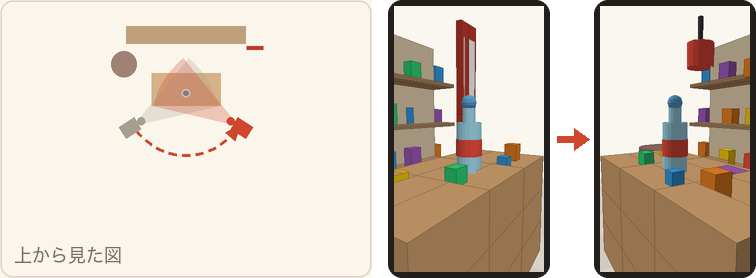
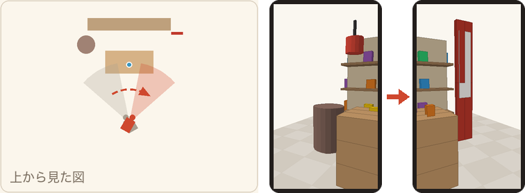
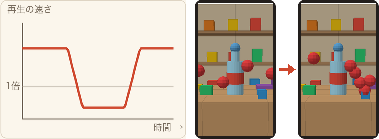
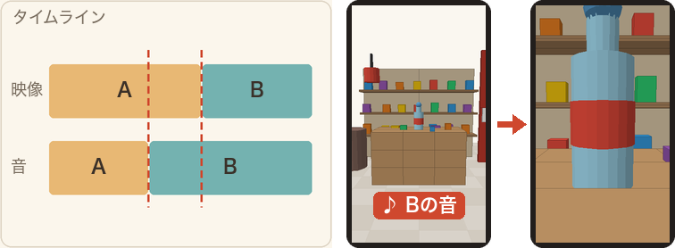
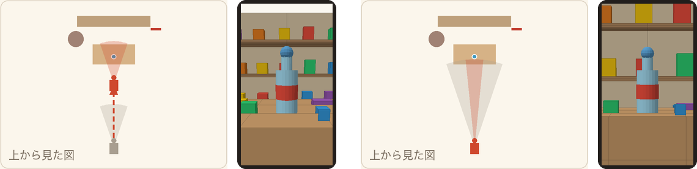

<!-- _class: lead -->
<!-- _paginate: false -->

# カメラワークとトランジション一覧
## スマホ撮影とPremiereで使える54の手法

動画基礎 2026年度後期　京都芸術デザイン専門学校 キャラクターデザインコース

---

<!-- _class: list c1 -->

# この資料の見方：図を左から右へ読む

見本の場面はどれも同じ駄菓子屋で、主役はカウンターの上のラムネ瓶です。画面はスマホの縦動画です。

<h3>カメラの動きを見る図</h3>
左の図はカメラを上か横から見たところで、灰色が動く前、赤が動いたあと、扇形が写る範囲、点線が動く道すじです。右の2つは、そのときスマホに映る画面です。

<h3>時間を見る図</h3>
左のグラフは再生の速さで、1倍が元の速さです。右の画面の赤い球は同じ時間ごとの位置を重ねたもので、間隔が狭いほどゆっくり見えます。

<h3>つなぎ方を見る図</h3>
左の図はPremiereのタイムラインと同じ形で、上が映像、下が音です。赤い点線が切り替わる位置で、AとBは前後のカットです。トランジションは4コマで変化を見せます。

撮る撮影のときに作る編集編集で作る撮る＋編集撮り方と編集の両方が要る道具が要るスマホだけでは難しい

各手法の説明は、<b>内容</b>（何をするか）、<b>効果</b>（見る人にどう伝わるか）、<b>やり方</b>、<b>例</b> の順に並べています。

---

<!-- _class: list c1 -->

# 54の手法を1枚で見る（右の数字がページ）

<h3>動かす：位置は変えない</h3>
<b>フィックス</b>4

<b>パン</b>4

<b>ティルト</b>4

<b>ズーム</b>4
<h3>動かす：カメラごと移動する</h3>
<b>ドリーイン</b>5

<b>ドリーアウト</b>5

<b>トラッキング</b>5

<b>アーク</b>5
<h3>見え方：高さと角度</h3>
<b>クレーン</b>6

<b>ローアングル</b>6

<b>ハイアングル</b>6

<b>真上から</b>6

<h3>見え方：画面に表情をつける</h3>
<b>ダッチアングル</b>7

<b>ラックフォーカス</b>7

<b>ハンドヘルド</b>7

<b>ドリーズーム</b>7
<h3>時間：再生の速さ</h3>
<b>スローモーション</b>8

<b>早回し</b>8

<b>スピードランプ</b>8

<b>フリーズフレーム</b>8
<h3>時間：長い時間を縮める</h3>
<b>タイムラプス</b>9

<b>ハイパーラプス</b>9
<h3>カット：映像</h3>
<b>カット</b>10

<b>ジャンプカット</b>10

<b>マッチカット</b>10

<b>カットアウェイ</b>10

<h3>カット：音</h3>
<b>スマッシュカット</b>11

<b>Jカット</b>11

<b>Lカット</b>11
<h3>Premiere：ディゾルブ</h3>
<b>クロスディゾルブ</b>13

<b>暗転</b>13

<b>ホワイトアウト</b>13

<b>ぼかしディゾルブ</b>13
<h3>Premiere：ワイプ</h3>
<b>リニアワイプ</b>14

<b>クロックワイプ</b>14

<b>スターワイプ</b>14

<b>ソフトワイプ</b>14
<h3>Premiere：スライド</h3>
<b>押し出し</b>15

<b>スライド</b>15

<b>スプリット</b>15

<b>ホイップ</b>15

<h3>Premiere：トランスフォーマー</h3>
<b>ページピール</b>16

<b>3D スピン</b>16

<b>ルーバー</b>16

<b>フィルムロール</b>16
<h3>Premiere：ライトとぼかし</h3>
<b>クロスズーム</b>17

<b>Flash</b>17

<b>ライトリーク</b>17
<h3>Premiere：グランジ、アニメーション</h3>
<b>グリッチ</b>18

<b>VHS 劣化</b>18

<b>テレビ電源</b>18

<b>ポップモーション</b>18
<h3>レガシーと撮影</h3>
<b>アイリス (円形)</b>19

<b>隠して切り替える</b>19

---

<!-- _class: list c1 -->

# カメラを動かす：位置は変えない

<video src="videos/fix.mp4" autoplay loop muted playsinline></video>

<h3>フィックス<small>Fix</small>撮る</h3><dl><dt>内容</dt><dd>カメラを動かさず、固定して撮る</dd><dt>効果</dt><dd>見る人が落ち着いて中身を見られるので、動画の基本になる</dd><dt>やり方</dt><dd>三脚を使うか、壁や机に体を預けて5秒以上止めて撮る</dd><dt>例</dt><dd>駄菓子の棚の全体を見せる</dd></dl>

<video src="videos/pan.mp4" autoplay loop muted playsinline></video>

<h3>パン<small>Pan</small>撮る</h3><dl><dt>内容</dt><dd>カメラの位置はそのままで、向きを左右に振る</dd><dt>効果</dt><dd>横の広がりや、離れた2つのものの関係を見せる</dd><dt>やり方</dt><dd>足を固定して腰から回し、動く前と後で2秒止める</dd><dt>例</dt><dd>棚の左から右へ、並んだ駄菓子を見せる</dd></dl>

<video src="videos/tilt.mp4" autoplay loop muted playsinline></video>

<h3>ティルト<small>Tilt</small>撮る</h3><dl><dt>内容</dt><dd>カメラの位置はそのままで、向きを上下に振る</dd><dt>効果</dt><dd>高さや大きさを見せて、見上げる気持ちを作る</dd><dt>やり方</dt><dd>肘を体につけて、スマホの向きだけをゆっくり変える</dd><dt>例</dt><dd>足もとの樽から、上の提灯へ上げる</dd></dl>

<video src="videos/zoom.mp4" autoplay loop muted playsinline></video>

<h3>ズーム<small>Zoom</small>撮る＋編集</h3><dl><dt>内容</dt><dd>カメラは動かず、写る範囲を変えて寄る・引く</dd><dt>効果</dt><dd>背景も一緒に大きくなり、動かずに注目させられる</dd><dt>やり方</dt><dd>撮りながらのピンチは画質が落ちるので、編集のスケールで動かす</dd><dt>例</dt><dd>看板の文字へ一気に寄る</dd></dl>

---

<!-- _class: list c1 -->

# カメラを動かす：カメラごと移動する

<video src="videos/dolly_in.mp4" autoplay loop muted playsinline></video>

<h3>ドリーイン<small>Dolly in</small>撮る</h3><dl><dt>内容</dt><dd>カメラごと被写体へ近づく</dd><dt>効果</dt><dd>主役へ引き込み、見る人の気持ちを高める</dd><dt>やり方</dt><dd>脇を締めて、すり足で歩いて近づく</dd><dt>例</dt><dd>店の入口から、カウンターのラムネまで進む</dd></dl>

<video src="videos/dolly_out.mp4" autoplay loop muted playsinline></video>

<h3>ドリーアウト<small>Dolly out</small>撮る</h3><dl><dt>内容</dt><dd>カメラごと被写体から離れる</dd><dt>効果</dt><dd>まわりの様子が見えてきて、場面が締まる</dd><dt>やり方</dt><dd>後ろを人に見てもらいながら、ゆっくり下がる</dd><dt>例</dt><dd>ラムネのアップから下がり、店全体を見せて終わる</dd></dl>

<video src="videos/tracking.mp4" autoplay loop muted playsinline></video>

<h3>トラッキング<small>Tracking shot</small>撮る</h3><dl><dt>内容</dt><dd>動く被写体に合わせて、カメラも一緒に移動する</dd><dt>効果</dt><dd>一緒に動いている感じと、背景が流れるスピード感が出る</dd><dt>やり方</dt><dd>距離を保って並んで歩き、被写体を画面の同じ位置に収める</dd><dt>例</dt><dd>カウンターを転がるビー玉を横から追う</dd></dl>

<video src="videos/arc.mp4" autoplay loop muted playsinline></video>

<h3>アーク<small>Arc shot</small>撮る回り込み・オービットとも呼ぶ</h3><dl><dt>内容</dt><dd>被写体を中心に、円を描くように回り込む</dd><dt>効果</dt><dd>主役を立体的に見せ、特別な瞬間のように見せる</dd><dt>やり方</dt><dd>距離を保って横歩きし、スマホを主役に向け続ける</dd><dt>例</dt><dd>カウンターのラムネのまわりを半周する</dd></dl>

---

<!-- _class: list c2 -->

# 見え方を変える：高さと角度

<video src="videos/crane.mp4" autoplay loop muted playsinline></video>

<h3>クレーン<small>Crane shot</small>撮る</h3><dl><dt>内容</dt><dd>カメラの高さを上下に変える</dd><dt>効果</dt><dd>上がると全体が見えてきて、場面が広がる</dd><dt>やり方</dt><dd>しゃがんだ姿勢から、腕を伸ばしながら立ち上がる</dd><dt>例</dt><dd>低い位置から上がって、カウンターの上を見下ろす</dd></dl>

<video src="videos/low.mp4" autoplay loop muted playsinline></video>

<h3>ローアングル<small>Low angle</small>撮る</h3><dl><dt>内容</dt><dd>被写体より低い位置から、見上げて撮る</dd><dt>効果</dt><dd>主役が大きく、力強く見える</dd><dt>やり方</dt><dd>スマホを逆さに持つと、レンズが下に来て低く構えやすい</dd><dt>例</dt><dd>カウンターのラムネを、すれすれの高さから見上げる</dd></dl>

<video src="videos/high.mp4" autoplay loop muted playsinline></video>

<h3>ハイアングル<small>High angle</small>撮る</h3><dl><dt>内容</dt><dd>被写体より高い位置から、見下ろして撮る</dd><dt>効果</dt><dd>全体の配置が分かり、被写体が小さくかわいらしく見える</dd><dt>やり方</dt><dd>腕を上に伸ばし、画面が見えにくいので先に録画を始める</dd><dt>例</dt><dd>カウンターの上の駄菓子を上から見せる</dd></dl>

<video src="videos/top.mp4" autoplay loop muted playsinline></video>

<h3>真上から<small>Top shot</small>撮る俯瞰（ふかん）とも呼ぶ</h3><dl><dt>内容</dt><dd>被写体の真上から、まっすぐ見下ろして撮る</dd><dt>効果</dt><dd>並びや形がよく分かり、図鑑のような画面になる</dd><dt>やり方</dt><dd>スマホを水平に構え、自分の影が入らない位置に立つ</dd><dt>例</dt><dd>駄菓子を机に並べて、真上から撮る</dd></dl>

---

<!-- _class: list c2 -->

# 見え方を変える：画面に表情をつける

<video src="videos/dutch.mp4" autoplay loop muted playsinline></video>

<h3>ダッチアングル<small>Dutch angle</small>撮る</h3><dl><dt>内容</dt><dd>カメラを傾けて、水平をわざとくずす</dd><dt>効果</dt><dd>不安や違和感、にぎやかな勢いが出る</dd><dt>やり方</dt><dd>スマホを10〜20度傾けて撮る（編集の回転と拡大でも作れる）</dd><dt>例</dt><dd>看板が並ぶ通路を斜めに見せる</dd></dl>

<video src="videos/rack.mp4" autoplay loop muted playsinline></video>

<h3>ラックフォーカス<small>Rack focus</small>撮る</h3><dl><dt>内容</dt><dd>構図はそのままで、ピントを手前から奥へ移す</dd><dt>効果</dt><dd>見てほしいものへ視線を動かせる</dd><dt>やり方</dt><dd>手前の物にぐっと近づき、撮影中に奥をタップする</dd><dt>例</dt><dd>手前のラムネから、奥の棚へピントを移す</dd></dl>

<video src="videos/handheld.mp4" autoplay loop muted playsinline></video>

<h3>ハンドヘルド<small>Handheld</small>撮る</h3><dl><dt>内容</dt><dd>手で持った小さな揺れを、わざと残して撮る</dd><dt>効果</dt><dd>その場にいるような臨場感が出る</dd><dt>やり方</dt><dd>手で持って歩くが、揺れが大きいと見る人が酔うので小さく抑える</dd><dt>例</dt><dd>友達と店を見て回る場面</dd></dl>

<video src="videos/dollyzoom.mp4" autoplay loop muted playsinline></video>

<h3>ドリーズーム<small>Dolly zoom</small>道具が要る</h3><dl><dt>内容</dt><dd>下がりながらズームインして、被写体の大きさを保つ</dd><dt>効果</dt><dd>背景だけが迫ってきて、めまいのような不安が出る</dd><dt>やり方</dt><dd>下がる速さとズームをそろえるのが難しいので、ジンバルなどを使う</dd><dt>例</dt><dd>主役が何かに気づいた瞬間</dd></dl>

---

<!-- _class: list c3 -->

# 時間を変える：再生の速さ

<video src="videos/slow.mp4" autoplay loop muted playsinline></video>

<h3>スローモーション<small>Slow motion</small>撮る＋編集</h3><dl><dt>内容</dt><dd>動きをゆっくり再生する</dd><dt>効果</dt><dd>一瞬を長く見せ、美しさや迫力を強める</dd><dt>やり方</dt><dd>スマホのスローで撮るか、60fpsで撮って速度を50%にする</dd><dt>例</dt><dd>ビー玉が弾む瞬間</dd></dl>

<video src="videos/fast.mp4" autoplay loop muted playsinline></video>

<h3>早回し<small>Fast motion</small>編集</h3><dl><dt>内容</dt><dd>動きを速く再生する</dd><dt>効果</dt><dd>長い作業を短く見せ、コミカルな勢いが出る</dd><dt>やり方</dt><dd>右クリック ＞「速度・デュレーション」で200〜400%にする</dd><dt>例</dt><dd>駄菓子を選ぶ様子を数秒に縮める</dd></dl>

<video src="videos/ramp.mp4" autoplay loop muted playsinline></video>

<h3>スピードランプ<small>Speed ramp</small>編集</h3><dl><dt>内容</dt><dd>1カットの途中で、再生の速さを変える</dd><dt>効果</dt><dd>速い→遅いの落差で、見せ場が際立つ</dd><dt>やり方</dt><dd>クリップの「タイムリマップ」＞「速度」にキーフレームを打つ</dd><dt>例</dt><dd>早足で進み、棚の前でゆっくりにする</dd></dl>

<video src="videos/freeze.mp4" autoplay loop muted playsinline></video>

<h3>フリーズフレーム<small>Freeze frame</small>編集</h3><dl><dt>内容</dt><dd>動きの途中で、映像を止める</dd><dt>効果</dt><dd>決定的な瞬間を強調し、文字を読ませる間を作る</dd><dt>やり方</dt><dd>止めたい位置で右クリック ＞「フレーム保持セグメントを挿入」</dd><dt>例</dt><dd>駄菓子を手に取った瞬間で止めて、値段を出す</dd></dl>

---

<!-- _class: list c3 -->

# 時間を変える：長い時間を縮める

<video src="videos/timelapse.mp4" autoplay loop muted playsinline></video>

<h3>タイムラプス<small>Time-lapse</small>撮る</h3><dl><dt>内容</dt><dd>長い時間を間引いて撮り、数秒に縮める</dd><dt>効果</dt><dd>時間の流れや、人の行き来を見せる</dd><dt>やり方</dt><dd>スマホを固定して、カメラのタイムラプスで撮る</dd><dt>例</dt><dd>昼から夕方へ変わる店先</dd></dl>

<video src="videos/hyperlapse.mp4" autoplay loop muted playsinline></video>

<h3>ハイパーラプス<small>Hyperlapse</small>撮る</h3><dl><dt>内容</dt><dd>少しずつ移動しながら撮るタイムラプス</dd><dt>効果</dt><dd>長い距離を一気に進む、スピード感のある映像になる</dd><dt>やり方</dt><dd>タイムラプスのまま、スマホを両手で構えてゆっくり歩く</dd><dt>例</dt><dd>通路の入口から奥の店まで、数秒で進む</dd></dl>

<b>ゆっくりにしたいカットは、撮る前に決める。</b>30fpsの素材を50%にすると同じコマが2回ずつ映ってカクつくので、なめらかにしたいカットは高いフレームレートで撮っておく。
<table class="mini"><tr><th>撮るときのfps</th><td>30fps</td><td>60fps</td><td>120fps</td><td>240fps</td></tr><tr><th>30fpsの動画で、なめらかに遅くできる限度</th><td>100%</td><td>50%</td><td>25%</td><td>12.5%</td></tr></table>

---

<!-- _class: list c4 -->

# カットでつなぐ：映像

<video src="videos/cut.mp4" autoplay loop muted playsinline></video>

<h3>カット<small>Cut</small>編集</h3><dl><dt>内容</dt><dd>2つのカットを、効果なしでそのままつなぐ</dd><dt>効果</dt><dd>いちばん自然で、見る人が切り替えを意識しない</dd><dt>やり方</dt><dd>動きや視線がつながる位置で切って並べる</dd><dt>例</dt><dd>店の全景から、カウンターの上へ切り替える</dd></dl>

<video src="videos/jump.mp4" autoplay loop muted playsinline></video>

<h3>ジャンプカット<small>Jump cut</small>編集</h3><dl><dt>内容</dt><dd>同じ構図のまま、途中を抜いてつなぐ</dd><dt>効果</dt><dd>動きが飛んでテンポが上がり、時間の経過も見せられる</dd><dt>やり方</dt><dd>固定して撮り、レーザー（C）で切って間をリップル削除する</dd><dt>例</dt><dd>カウンターの駄菓子が、どんどん増えていく</dd></dl>

<video src="videos/match.mp4" autoplay loop muted playsinline></video>

<h3>マッチカット<small>Match cut</small>撮る＋編集</h3><dl><dt>内容</dt><dd>形や動きが似た2つのカットをつなぐ</dd><dt>効果</dt><dd>別の場面が1つにつながり、印象に残る</dd><dt>やり方</dt><dd>似た形が画面の同じ位置に来るように、2カットを撮る</dd><dt>例</dt><dd>丸いラムネの栓から、丸い提灯へ</dd></dl>

<video src="videos/cutaway.mp4" autoplay loop muted playsinline></video>

<h3>カットアウェイ<small>Cutaway</small>撮る＋編集インサートとも呼ぶ</h3><dl><dt>内容</dt><dd>カットの途中に、関係する別のカットを短く挟む</dd><dt>効果</dt><dd>説明を補い、長いカットのだれを防ぐ</dd><dt>やり方</dt><dd>手元や商品のアップを撮っておき、上のトラックに重ねる</dd><dt>例</dt><dd>店の全景の途中に、ラムネのアップを挟む</dd></dl>

---

<!-- _class: list c4 -->

# カットでつなぐ：音

<video src="videos/smash.mp4" autoplay loop muted playsinline></video>

<h3>スマッシュカット<small>Smash cut</small>編集</h3><dl><dt>内容</dt><dd>静かな場面から、いきなり大きな音の場面へ変える</dd><dt>効果</dt><dd>落差で驚きや笑いが生まれる</dd><dt>やり方</dt><dd>トランジションを入れず、音と動きの差が大きい2カットをつなぐ</dd><dt>例</dt><dd>静かな店内から、ラムネの栓を開ける音へ</dd></dl>

<video src="videos/jcut.mp4" autoplay loop muted playsinline></video>

<h3>Jカット<small>J-cut</small>編集</h3><dl><dt>内容</dt><dd>次のカットの音が、映像より先に聞こえ始める</dd><dt>効果</dt><dd>「次は何だろう」と引き込む</dd><dt>やり方</dt><dd>ローリングツール（N）とAltで、音のつなぎ目だけを前へ動かす</dd><dt>例</dt><dd>ラムネの音が先に聞こえて、次にラムネが映る</dd></dl>

<video src="videos/lcut.mp4" autoplay loop muted playsinline></video>

<h3>Lカット<small>L-cut</small>編集</h3><dl><dt>内容</dt><dd>映像が次へ移っても、前のカットの音が残る</dd><dt>効果</dt><dd>場面が途切れず、余韻が続く</dd><dt>やり方</dt><dd>ローリングツール（N）とAltで、音のつなぎ目だけを後ろへ動かす</dd><dt>例</dt><dd>店のざわめきを残したまま、次の棚へ移る</dd></dl>

<b>音をずらすだけで、切り替えは自然になる。</b>映像と音を同じ位置で切ると切り替えが目立つので、音だけを少し前後にずらすと、見る人は切れ目を意識しにくくなる。

---

<!-- _class: list c5 -->

# Premiereのトランジションは、フォルダから探す

<table>
<tr><th>フォルダ（数）</th><th>入っているもの</th><th>代表</th></tr>
<tr><td><b>ディゾルブ</b>（10）</td><td>重ねて切り替える基本</td><td>クロスディゾルブ、暗転、ホワイトアウト</td></tr>
<tr><td><b>ワイプ</b>（9）</td><td>線や形で入れ替える</td><td>リニアワイプ、クロックワイプ</td></tr>
<tr><td><b>スライド</b>（8）</td><td>画面ごと動かす</td><td>押し出し、ホイップ、フィルムロール</td></tr>
<tr><td><b>トランスフォーマー</b>（8）</td><td>画面を立体的に変形する</td><td>ページピール、3D スピン</td></tr>
<tr><td><b>ライトとぼかし</b>（16）</td><td>光やぼけで切り替える</td><td>クロスズーム、Flash、ライトリーク</td></tr>
<tr><td><b>グランジとディストーション</b>（10）</td><td>映像を乱して切り替える</td><td>グリッチ、VHS 劣化</td></tr>
<tr><td><b>アニメーション</b>（8）</td><td>文字や図形を動かして出す</td><td>ポップモーション</td></tr>
<tr><td><b>スマートツール</b>（4）<b>テキスト</b>（2）</td><td>形や文字に合わせて動かす</td><td>シェイプフロー、タイプライター</td></tr>
<tr><td><b>レガシー</b></td><td>古い版から残されたもの</td><td>アイリス (円形)</td></tr>
</table>

<h3>使い方</h3>
<ol><li>エフェクトパネルの検索欄に、名前を打つ</li><li>カットのつなぎ目へドラッグする</li><li>つなぎ目をダブルクリックして、長さを決める</li></ol>
<h3>ショートカット</h3>

<kbd>Ctrl</kbd>+<kbd>D</kbd> デフォルトのトランジションを映像に入れる <kbd>Shift</kbd>+<kbd>D</kbd> 映像と音の両方に入れる

<h3>動きを見て選ぶ</h3>

ウィンドウ ＞ エクステンション ＞ Film Impact Dashboard

名前とフォルダは <b>Premiere 2026（26.5）</b> のものです。26.0で大きく整理されたので、2025以前の版や古い解説記事では、名前と場所が違うことがあります。

---

<!-- _class: list c5 -->

# Premiereのトランジション：ディゾルブ

<video src="videos/dissolve.mp4" autoplay loop muted playsinline></video>

<h3>クロスディゾルブ<small>Cross dissolve</small>編集オーバーラップとも呼ぶ</h3><dl><dt>内容</dt><dd>前のカットが薄れながら、次のカットが現れる</dd><dt>効果</dt><dd>時間や場所が変わった感じと、余韻が出る</dd><dt>やり方</dt><dd>つなぎ目にクロスディゾルブを置き、10〜15フレームにする</dd><dt>例</dt><dd>昼の店先から、夕方の店先へ</dd></dl>

<video src="videos/fade.mp4" autoplay loop muted playsinline></video>

<h3>暗転<small>Dip to Black</small>編集フェードアウト・フェードインとも呼ぶ</h3><dl><dt>内容</dt><dd>画面がいったん黒くなり、次のカットが現れる</dd><dt>効果</dt><dd>話の区切りをはっきり見せる</dd><dt>やり方</dt><dd>動画の最後や、話が大きく変わるところに置く</dd><dt>例</dt><dd>動画の最後を静かに閉じる</dd></dl>

<video src="videos/whiteout.mp4" autoplay loop muted playsinline></video>

<h3>ホワイトアウト<small>Dip to White</small>編集</h3><dl><dt>内容</dt><dd>画面がいったん白くなり、次のカットが現れる</dd><dt>効果</dt><dd>まぶしさや、回想のような切り替えになる</dd><dt>やり方</dt><dd>長めにすると回想の入口になり、6フレームほどなら一瞬光る</dd><dt>例</dt><dd>昔の思い出の場面へ入る</dd></dl>

<video src="videos/blurdiss.mp4" autoplay loop muted playsinline></video>

<h3>ぼかしディゾルブ<small>Blur Dissolve</small>編集</h3><dl><dt>内容</dt><dd>映像がぼけながら、次のカットへ溶けていく</dd><dt>効果</dt><dd>夢の中のような、やわらかい切り替えになる</dd><dt>やり方</dt><dd>15〜20フレームと長めにして、静かな場面で使う</dd><dt>例</dt><dd>回想の場面へ入る</dd></dl>

---

<!-- _class: list c5 -->

# Premiereのトランジション：ワイプ

<video src="videos/wipe.mp4" autoplay loop muted playsinline></video>

<h3>リニアワイプ<small>Linear Wipe</small>編集ワイプとも呼ぶ</h3><dl><dt>内容</dt><dd>線が画面を横切り、次のカットに入れ替わる</dd><dt>効果</dt><dd>場面をはっきり区切り、どこかレトロな感じが出る</dd><dt>やり方</dt><dd>話題が変わるつなぎ目に置き、12〜15フレームにする</dd><dt>例</dt><dd>駄菓子の話から、看板の話へ変える</dd></dl>

<video src="videos/clock.mp4" autoplay loop muted playsinline></video>

<h3>クロックワイプ<small>Clock Wipe</small>編集</h3><dl><dt>内容</dt><dd>時計の針が回るように、次のカットに入れ替わる</dd><dt>効果</dt><dd>時間が進んだ感じが出る</dd><dt>やり方</dt><dd>20〜30フレームと長めにして、回る様子を見せる</dd><dt>例</dt><dd>開店前の店先から、にぎわう店先へ</dd></dl>

<video src="videos/star.mp4" autoplay loop muted playsinline></video>

<h3>スターワイプ<small>Star Wipe</small>編集</h3><dl><dt>内容</dt><dd>星の形が広がり、次のカットに入れ替わる</dd><dt>効果</dt><dd>にぎやかで、遊びのある切り替えになる</dd><dt>やり方</dt><dd>目立つので、1本に1回までにする</dd><dt>例</dt><dd>くじの当たりが出た場面</dd></dl>

<video src="videos/softwipe.mp4" autoplay loop muted playsinline></video>

<h3>ソフトワイプ<small>Soft Wipe</small>編集</h3><dl><dt>内容</dt><dd>境目をぼかしたまま、横へ入れ替わる</dd><dt>効果</dt><dd>リニアワイプより静かに場面が変わる</dd><dt>やり方</dt><dd>15〜20フレームで、落ち着いた場面どうしをつなぐ</dd><dt>例</dt><dd>棚から隣の棚へ移る</dd></dl>

---

<!-- _class: list c5 -->

# Premiereのトランジション：スライド

<video src="videos/push.mp4" autoplay loop muted playsinline></video>

<h3>押し出し<small>Push</small>編集プッシュとも呼ぶ</h3><dl><dt>内容</dt><dd>次のカットが、前のカットを画面の外へ押し出す</dd><dt>効果</dt><dd>話が横へ流れるように続く</dd><dt>やり方</dt><dd>押す向きを、カットの中で動く向きにそろえる</dd><dt>例</dt><dd>棚を見ながら、右へ移っていく</dd></dl>

<video src="videos/slide.mp4" autoplay loop muted playsinline></video>

<h3>スライド<small>Slide</small>編集</h3><dl><dt>内容</dt><dd>前のカットは動かず、次のカットが上にすべり込む</dd><dt>効果</dt><dd>新しいものが現れた感じが出る</dd><dt>やり方</dt><dd>前のカットも動かしたいときは、押し出しを使う</dd><dt>例</dt><dd>商品のカットを次々に重ねる</dd></dl>

<video src="videos/split.mp4" autoplay loop muted playsinline></video>

<h3>スプリット<small>Split</small>編集</h3><dl><dt>内容</dt><dd>前のカットが2つに割れ、間から次のカットが現れる</dd><dt>効果</dt><dd>扉が開くような、始まりの感じが出る</dd><dt>やり方</dt><dd>割れる線が主役にかからないカットで使う</dd><dt>例</dt><dd>店の入口から店内へ入る</dd></dl>

<video src="videos/whip.mp4" autoplay loop muted playsinline></video>

<h3>ホイップ<small>Whip</small>撮る＋編集ホイップパンとも呼ぶ</h3><dl><dt>内容</dt><dd>カメラを素早く振ったようなブレの中で、次の場面へ移る</dd><dt>効果</dt><dd>勢いよく場所が変わる</dd><dt>やり方</dt><dd>つなぎ目に置くだけで作れる（撮るなら2カットを同じ向きに素早く振る）</dd><dt>例</dt><dd>店の全景から、ラムネのアップへ飛ぶ</dd></dl>

---

<!-- _class: list c5 -->

# Premiereのトランジション：トランスフォーマーとフィルムロール

<video src="videos/peel.mp4" autoplay loop muted playsinline></video>

<h3>ページピール<small>Page Peel</small>編集</h3><dl><dt>内容</dt><dd>前のカットが紙のようにめくれて、次のカットが現れる</dd><dt>効果</dt><dd>本やアルバムをめくるような、物語の感じが出る</dd><dt>やり方</dt><dd>章の変わり目に使い、1本で1〜2回にする</dd><dt>例</dt><dd>昔のアルバムをめくるように次の場面へ</dd></dl>

<video src="videos/spin.mp4" autoplay loop muted playsinline></video>

<h3>3D スピン<small>3D Spin</small>編集</h3><dl><dt>内容</dt><dd>画面が立体的に回り、裏から次のカットが現れる</dd><dt>効果</dt><dd>勢いよく場面が変わる</dd><dt>やり方</dt><dd>曲の強い拍に合わせて、短く使う</dd><dt>例</dt><dd>曲のサビに入るところ</dd></dl>

<video src="videos/louver.mp4" autoplay loop muted playsinline></video>

<h3>ルーバー<small>Louver</small>編集</h3><dl><dt>内容</dt><dd>羽根板が回るように、細い帯ごとに入れ替わる</dd><dt>効果</dt><dd>ブラインドを開けるような、きびきびした切り替えになる</dd><dt>やり方</dt><dd>帯が見えるように、20フレーム以上にする</dd><dt>例</dt><dd>店が開く場面</dd></dl>

<video src="videos/film.mp4" autoplay loop muted playsinline></video>

<h3>フィルムロール<small>Film Roll</small>編集スライドのフォルダにある</h3><dl><dt>内容</dt><dd>映画のフィルムが流れるように、次のカットへ送られる</dd><dt>効果</dt><dd>昔の映画のような、レトロな感じが出る</dd><dt>やり方</dt><dd>30フレーム前後で、ゆっくり見せる</dd><dt>例</dt><dd>昭和の街並みのカットをつなぐ</dd></dl>

---

<!-- _class: list c5 -->

# Premiereのトランジション：ライトとぼかし

<video src="videos/crosszoom.mp4" autoplay loop muted playsinline></video>

<h3>クロスズーム<small>Cross Zoom</small>編集</h3><dl><dt>内容</dt><dd>画面の中心へ吸い込まれて、次のカットへ飛ぶ</dd><dt>効果</dt><dd>一気に引き込まれる勢いが出る</dd><dt>やり方</dt><dd>前のカットの主役を、画面の中心に置いておく</dd><dt>例</dt><dd>ラムネにぐっと寄って、次の場面へ飛ぶ</dd></dl>

<video src="videos/flash.mp4" autoplay loop muted playsinline></video>

<h3>Flash<small>Flash</small>編集表示は英語のまま</h3><dl><dt>内容</dt><dd>強い光で白くなり、次のカットへ移る</dd><dt>効果</dt><dd>シャッターを切ったような勢いが出る</dd><dt>やり方</dt><dd>6〜10フレームで短くして、曲の拍に合わせる</dd><dt>例</dt><dd>写真を撮る瞬間</dd></dl>

<video src="videos/leak.mp4" autoplay loop muted playsinline></video>

<h3>ライトリーク<small>Light Leak</small>編集</h3><dl><dt>内容</dt><dd>温かい色の光が差し込みながら、次のカットへ移る</dd><dt>効果</dt><dd>古いフィルムのような、なつかしい雰囲気が出る</dd><dt>やり方</dt><dd>20フレーム以上で、ゆっくり光を見せる</dd><dt>例</dt><dd>昭和の店先から、夕方の通りへ</dd></dl>

<b>光やぼかしは目立つので、1本に1〜2回にする。</b>どれも「ここで場面が変わる」と強く伝わるので、いちばん見せたい切り替えだけに使うと効く。

---

<!-- _class: list c5 -->

# Premiereのトランジション：グランジとディストーション、アニメーション

<video src="videos/glitch.mp4" autoplay loop muted playsinline></video>

<h3>グリッチ<small>Glitch</small>編集</h3><dl><dt>内容</dt><dd>映像がデジタルに乱れて、次のカットへ移る</dd><dt>効果</dt><dd>ゲーム画面のような緊張感と勢いが出る</dd><dt>やり方</dt><dd>10フレーム前後で短く使う</dd><dt>例</dt><dd>ゲームの場面へ切り替える</dd></dl>

<video src="videos/vhs.mp4" autoplay loop muted playsinline></video>

<h3>VHS 劣化<small>VHS Damage</small>編集</h3><dl><dt>内容</dt><dd>ビデオテープが傷んだように乱れて、次のカットへ移る</dd><dt>効果</dt><dd>昔のビデオのような、なつかしさが出る</dd><dt>やり方</dt><dd>文字が読めなくなるので、テロップのないカットで使う</dd><dt>例</dt><dd>昔の映像を見返している演出</dd></dl>

<video src="videos/tv.mp4" autoplay loop muted playsinline></video>

<h3>テレビ電源<small>TV Power</small>編集</h3><dl><dt>内容</dt><dd>画面が線のようにつぶれて消え、次のカットがつく</dd><dt>効果</dt><dd>ブラウン管テレビの電源を切ったような切り替えになる</dd><dt>やり方</dt><dd>話の終わりに使うと、きれいに締まる</dd><dt>例</dt><dd>昭和のテレビの演出で話を締める</dd></dl>

<video src="videos/pop.mp4" autoplay loop muted playsinline></video>

<h3>ポップモーション<small>Pop Motion</small>編集アニメーションのフォルダにある</h3><dl><dt>内容</dt><dd>文字や図形が、ポンと弾むように現れる</dd><dt>効果</dt><dd>SNSらしい軽快な動きが出る</dd><dt>やり方</dt><dd>カットのつなぎ目ではなく、文字や図形のクリップの頭に置く</dd><dt>例</dt><dd>値段のステッカーを出す</dd></dl>

---

<!-- _class: list c5 -->

# レガシーのアイリスと、撮影で作る切り替え

<video src="videos/iris.mp4" autoplay loop muted playsinline></video>

<h3>アイリス (円形)<small>Iris Round</small>編集</h3><dl><dt>内容</dt><dd>丸い形が広がり、次のカットに入れ替わる</dd><dt>効果</dt><dd>昔の映画やアニメのような、かわいらしい切り替えになる</dd><dt>やり方</dt><dd>「レガシー」のフォルダの中にあるので、検索欄から探す</dd><dt>例</dt><dd>提灯の丸から、次のカットが開く</dd></dl>

<video src="videos/cover.mp4" autoplay loop muted playsinline></video>

<h3>隠して切り替える<small>Cover transition</small>撮る＋編集</h3><dl><dt>内容</dt><dd>手や物でレンズを隠し、隠れた瞬間に次のカットへ移る</dd><dt>効果</dt><dd>切れ目が見えず、場面が魔法のように変わる</dd><dt>やり方</dt><dd>前のカットの終わりと次のカットの頭を、どちらも隠した状態で撮る</dd><dt>例</dt><dd>手でレンズを隠して、別の店へ移る</dd></dl>

<b>長さの目安は10〜15フレーム（30fpsで約0.3〜0.5秒）。</b>トランジションは前後のカットの余りを使うので、動画のカットは前後に1秒ずつ余分に撮っておく。余りがないと、同じコマが繰り返されて止まって見える。

---

# やりたいことから、手法を選ぶ

| やりたいこと | 撮るときに使う | 編集で使う |
|---|---|---|
| 場所の広さを見せたい | パン、ドリーアウト、クレーン | クロスディゾルブ |
| 主役を目立たせたい | ドリーイン、ローアングル、ラックフォーカス | ズーム、フリーズフレーム |
| 細かいところを見せたい | 真上から、スローモーション | カットアウェイ |
| 動きに勢いをつけたい | トラッキング、ハイパーラプス | ジャンプカット、スピードランプ、ホイップ、クロスズーム |
| 見る人を驚かせたい | ダッチアングル、ドリーズーム | スマッシュカット、Flash、グリッチ |
| 時間の流れを見せたい | タイムラプス | 早回し、クロスディゾルブ、クロックワイプ |
| 話題を切り替えたい | 隠して切り替える | リニアワイプ、押し出し、Jカット |
| 余韻を残したい | ドリーアウト | 暗転、Lカット、ぼかしディゾルブ |
| 昔の映像のようにしたい | ハンドヘルド | フィルムロール、VHS 劣化、テレビ電源、ライトリーク、アイリス (円形) |

---

<!-- _class: list c1 -->

# 似ている手法は、ここで見分ける

<b>ドリー（左）とズーム（右）は、背景で見分ける。</b>どちらも瓶は同じ大きさでも、近づくドリーは背景が小さく広く写り、離れてズームすると背景が大きく迫って写る。

| 似ている組 | 見分け方 |
|---|---|
| パン・ティルト ／ ドリー・トラッキング・アーク | 向きだけが変わるか、カメラの位置が動くか |
| スローモーション ／ スピードランプ | ずっとゆっくりか、途中で速さが変わるか |
| ジャンプカット ／ スマッシュカット | 同じ場面の時間を飛ばすか、別の場面へ急に変えるか |
| Jカット ／ Lカット | 次の音が先に来るか、前の音が後に残るか |

---

# うまく使うコツは、動かす理由を決めること

| コツ | 理由 |
|---|---|
| 基本はフィックスにして、**理由があるカットだけ** 動かす | 理由のない動きは、見る人の気を散らす |
| 動くカットは、**始まりと終わりで2秒止める** | 止めがないと、編集で切る場所がなくなる |
| 動きは、自分が **遅すぎると思うくらい** にする | 速いパンは、何が映ったか分からない |
| 撮りながらズームせず、**足で寄るか編集で寄る** | スマホのピンチズームは画質が落ちる |
| トランジションは **場面が変わるところだけ** に使う | 全部のつなぎ目に付けると、かえって見にくい |
| 1本で目立たせる手法は **1つか2つ** にする | 見せたいのは手法より中身 |

---

# 絵コンテには、短い記号で書く

| 記号 | 読み方 | この資料の手法 |
|---|---|---|
| **FIX** | フィックス | フィックス |
| **PAN** | パン | パン（縦に振るときに使うこともある） |
| **T.U ／ T.B** | トラックアップ ／ トラックバック | ドリーイン ／ ドリーアウト |
| **Follow** | フォロー | トラッキング |
| **ZOOM** | ズーム | ズーム |
| **O.L** | オーバーラップ | クロスディゾルブ |
| **F.I ／ F.O** | フェードイン ／ フェードアウト | 暗転 |
| **W.I ／ W.O** | ホワイトイン ／ ホワイトアウト | ホワイトアウト |

カメラが動くカットは、コマの中に始めと終わりの枠を描いて、矢印でつなぐと伝わります

> 記号の書き方は現場によって少しずつ違うので、指定があるときはそれに合わせる
